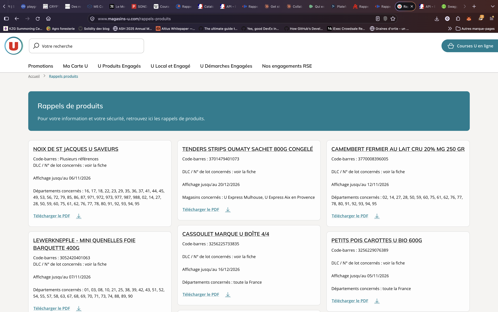

# CADI

**CADI** (Consommation Alerte Danger Informations) est une application qui prévient les consommateurs, par email, des rappels de produits en France. Chaque utilisateur choisit ce qu'il veut suivre : marques, produits, familles de produits, enseignes, magasins ou zone géographique.

L'application a deux objectifs :

1. faciliter l'accès aux informations sur les rappels de produits ;
2. suivre les rappels dans le temps, pour produire des statistiques par produit, marque, famille, enseigne et zone géographique.

## État du projet

Le projet est en phase de **spécification**.

- La spécification est dans [doc/specifications.md](doc/specifications.md) : fonctionnalités, conformité RGPD, modèle de données, workflows et architecture.
- Le dossier [src/](src/) contient un **prototype en ligne de commande** (Go). Il interroge l'API RappelConso et affiche les rappels récents d'une enseigne. Ce n'est pas encore l'application décrite dans la spécification.

## Organisation du dépôt

```
doc/
  specifications.md     spécification de l'application
  umldiagrams/          diagrammes PlantUML (.uml) et leurs images (.png)
    workflows/          un diagramme par workflow
img/                    captures d'écran utilisées dans ce README
src/                    prototype en ligne de commande (Go)
go.mod
```

## Sources des rappels

CADI s'appuie sur deux types de sources.

| Source | Format | Rôle |
|---|---|---|
| [RappelConso](https://rappel.conso.gouv.fr/), via l'API open data de [data.economie.gouv.fr](https://data.economie.gouv.fr/explore/dataset/rappelconso-v2-gtin-espaces/) | JSON structuré | Source de référence : la déclaration des rappels y est obligatoire depuis 2021. |
| Pages « rappels produits » des enseignes (Magasins U, Carrefour, E.Leclerc…) | HTML ou PDF, propre à chaque enseigne | Complément : magasins et départements concernés, date de fin d'affichage, rappels parfois absents de RappelConso. |

L'exemple ci-dessous montre pourquoi les deux sources sont utiles.

## Exemple : la page de rappels de Magasins U comparée à RappelConso

Voici la page [magasins-u.com/rappels-produits](https://www.magasins-u.com/rappels-produits), capturée le 27 octobre 2026 :



Les 6 rappels de cette page ont été recherchés dans l'API RappelConso, par code-barres ou par nom :

| Produit (page Magasins U) | Fiche RappelConso | Différences |
|---|---|---|
| Noix de St Jacques U Saveurs | [2026-10-0253](https://rappel.conso.gouv.fr/fiche-rappel/23926/interne), du 26/10 | **Zone** : RappelConso cite 5 départements, la page U en liste une cinquantaine, dont l'outre-mer. |
| Tenders strips Oumaty (3701479401073) | [2026-10-0229](https://rappel.conso.gouv.fr/fiche-rappel/23901/interne), du 21/10 | **Distributeurs** : RappelConso cite E.Leclerc, Carrefour… mais **pas U**. Seule la page U nomme les magasins concernés (U Express Mulhouse et U Express Aix-en-Provence). |
| Camembert fermier au lait cru (3770008396005) | [2026-10-0123](https://rappel.conso.gouv.fr/fiche-rappel/23794/interne), du 15/10 | **Zone** : « France entière » pour RappelConso, liste de départements pour la page U. |
| Lewerknepfle, mini quenelles de foie (3052420401063) | [2026-10-0159](https://rappel.conso.gouv.fr/fiche-rappel/23831/interne), du 19/10 | **Zone** : « France entière » pour RappelConso, liste de départements pour la page U. |
| Cassoulet U boîte 4/4 (3256225733835) | [2026-10-0175](https://rappel.conso.gouv.fr/fiche-rappel/23847/interne), du 19/10 | Les deux sources concordent. |
| Petits pois carottes U Bio (3256229076389) | **introuvable** | Ni le code-barres ni le nom ne donnent de résultat. |

**À retenir :**

- La plupart des rappels d'une enseigne sont dans RappelConso, avec des données structurées : motif, risques, lots, liens vers la fiche, l'affichette PDF et les images.
- La page de l'enseigne apporte des informations absentes de RappelConso : magasins et départements concernés pour cette enseigne, date de fin d'affichage, et parfois des rappels absents de RappelConso.
- Aucune fiche RappelConso de cet exemple n'a de date de fin d'affichage, et leur date de fin de procédure est vide.

### Reproduire les recherches avec curl

L'API est publique et ne demande pas de clé. Les commandes ci-dessous utilisent [jq](https://jqlang.org/) pour rendre le résultat lisible ; sans jq, retirez simplement la dernière ligne.

**Rechercher un rappel par code-barres** (ici les tenders strips Oumaty) :

```sh
curl -s --compressed -G \
  "https://data.economie.gouv.fr/api/explore/v2.1/catalog/datasets/rappelconso-v2-gtin-espaces/records" \
  --data-urlencode 'where="3701479401073"' \
  --data-urlencode 'select=numero_fiche,date_publication,marque_produit,libelle,distributeurs,zone_geographique_de_vente,lien_vers_la_fiche_rappel' \
  | jq '.results'
```

Remplacez `3701479401073` par l'un des autres codes-barres du tableau pour retrouver les autres rappels.

**Rechercher un rappel par nom** (ici les noix de Saint-Jacques, depuis septembre 2026) :

```sh
curl -s --compressed -G \
  "https://data.economie.gouv.fr/api/explore/v2.1/catalog/datasets/rappelconso-v2-gtin-espaces/records" \
  --data-urlencode 'where=search(libelle,"jacques") AND date_publication >= "2026-09-01"' \
  --data-urlencode 'order_by=date_publication desc' \
  --data-urlencode 'select=numero_fiche,date_publication,marque_produit,libelle,distributeurs,zone_geographique_de_vente,lien_vers_la_fiche_rappel' \
  | jq '.results'
```

**Lister les derniers rappels publiés** :

```sh
curl -s --compressed -G \
  "https://data.economie.gouv.fr/api/explore/v2.1/catalog/datasets/rappelconso-v2-gtin-espaces/records" \
  --data-urlencode 'order_by=date_publication desc' \
  --data-urlencode 'limit=10' \
  --data-urlencode 'select=numero_fiche,date_publication,marque_produit,libelle,distributeurs' \
  | jq '.results'
```

Les mêmes requêtes peuvent être testées dans l'interface Swagger de l'API ([lien](https://petstore.swagger.io/?url=https%3A%2F%2Fdata.economie.gouv.fr%2Fapi%2Fexplore%2Fv2.1%2Fswagger.json)), avec l'opération `GET /catalog/datasets/{dataset_id}/records` et `dataset_id` = `rappelconso-v2-gtin-espaces`.

### Pièges de l'API RappelConso

- **Le paramètre `q` est ignoré sans erreur** : il renvoie tous les rappels. Pour chercher, utilisez `where`.
- **Le code-barres n'a pas de champ dédié.** Il se trouve dans `identification_produits`, mélangé aux numéros de lot et aux dates.
- **Les distributeurs sont séparés par `¤`** dans le champ `distributeurs`, qui est du texte libre.
- **Les réponses sont compressées (gzip)** : il faut l'option `--compressed` de curl.
- **Les appels sont limités à 50 000 par jour** (en-têtes `x-ratelimit-*` des réponses).

## Prototype en ligne de commande

Le prototype affiche les rappels récents d'une enseigne. Il nécessite Go.

```sh
go run ./src -list                        # enseignes connues
go run ./src -enseigne leclerc            # nouveaux rappels E.Leclerc des 14 derniers jours
go run ./src -enseigne auchan -days 30 -all
go run ./src -enseigne carrefour -json
go test ./...
```

Il mémorise les rappels déjà affichés dans `state/<enseigne>.json` : lancé régulièrement (par exemple avec cron), il ne signale que les nouveaux.

## Diagrammes

Les diagrammes de [doc/umldiagrams/](doc/umldiagrams/) sont écrits avec [PlantUML](https://plantuml.com/). Pour régénérer une image après avoir modifié un fichier `.uml` :

```sh
plantuml -tpng doc/umldiagrams/workflows/alertecreation.uml
```
