# CADI

CADI (Consommation Alerte Danger Informations)
- [CADI](#cadi)
- [Introduction](#introduction)
  - [Objectif de l’application](#objectif-de-lapplication)
  - [Périmètre fonctionnel](#périmètre-fonctionnel)
  - [Périmètre technique](#périmètre-technique)
- [Architecture](#architecture)
- [Conformité](#conformité)
  - [Collecte et Traitement des Données](#collecte-et-traitement-des-données)
  - [Droits des Utilisateurs](#droits-des-utilisateurs)
  - [Droits des enseignes et des marques](#droits-des-enseignes-et-des-marques)
  - [Sécurité et Protection des Données](#sécurité-et-protection-des-données)
  - [Consentement et Cookies](#consentement-et-cookies)
  - [Sous-traitants et Partage des Données](#sous-traitants-et-partage-des-données)
  - [Durée de Conservation des Données](#durée-de-conservation-des-données)
  - [Point de Contact et DPO](#point-de-contact-et-dpo)
- [Sécurité](#sécurité)
- [Fonctionnalités](#fonctionnalités)
  - [Gouvernance](#gouvernance)
    - [Gouvernance des utilisateurs](#gouvernance-des-utilisateurs)
    - [Gouvernance des alertes](#gouvernance-des-alertes)
    - [Gouvernance des marques](#gouvernance-des-marques)
    - [Gouvernance des produits](#gouvernance-des-produits)
    - [Gouvernance des familles de produit](#gouvernance-des-familles-de-produit)
    - [Gouvernance des enseignes](#gouvernance-des-enseignes)
    - [Gouvernance des magasins](#gouvernance-des-magasins)
    - [Gouvernance des rappels](#gouvernance-des-rappels)
    - [Gouvernance du référentiel géographique](#gouvernance-du-référentiel-géographique)
    - [Gouvernance des statistiques](#gouvernance-des-statistiques)
- [Structures des données](#structures-des-données)
  - [Utilisateurs](#utilisateurs)
  - [Marques](#marques)
    - [Fusion de marques](#fusion-de-marques)
  - [Produits](#produits)
  - [Familles de produits](#familles-de-produits)
  - [Enseignes](#enseignes)
    - [Écritures d'enseigne](#écritures-denseigne)
  - [Magasins](#magasins)
  - [Alertes](#alertes)
    - [Alertes départements](#alertes-départements)
  - [Rappels](#rappels)
    - [Interprétation des textes libres](#interprétation-des-textes-libres)
    - [Interprétation des distributeurs](#interprétation-des-distributeurs)
  - [Sources des rappels](#sources-des-rappels)
  - [Collectes](#collectes)
    - [Rappels à traiter](#rappels-à-traiter)
  - [Liens entre les rappels et les autres données](#liens-entre-les-rappels-et-les-autres-données)
    - [Rappels produits](#rappels-produits)
    - [Rappels enseignes](#rappels-enseignes)
    - [Rappels magasin](#rappels-magasin)
    - [Rappels départements](#rappels-départements)
    - [Géographie par enseigne](#géographie-par-enseigne)
  - [Référentiel géographique](#référentiel-géographique)
    - [Départements](#départements)
    - [Appellations de zone](#appellations-de-zone)
    - [Zones départements](#zones-départements)
  - [Emails d'alerte](#emails-dalerte)
  - [Envois](#envois)
  - [Jetons de connexion](#jetons-de-connexion)
  - [Sessions](#sessions)
  - [Statistiques](#statistiques)
- [Workflow](#workflow)
  - [Suppression de données](#suppression-de-données)
  - [Workflows des utilisateurs](#workflows-des-utilisateurs)
    - [Connexion par lien magique](#connexion-par-lien-magique)
    - [Modification d'un utilisateur](#modification-dun-utilisateur)
    - [Déconnexion d'un utilisateur](#déconnexion-dun-utilisateur)
    - [Suppression d'un utilisateur](#suppression-dun-utilisateur)
    - [Export des données d'un utilisateur](#export-des-données-dun-utilisateur)
  - [Workflows des alertes](#workflows-des-alertes)
    - [Création d'une alerte](#création-dune-alerte)
    - [Modification d'une alerte](#modification-dune-alerte)
    - [Suppression d'une alerte](#suppression-dune-alerte)
    - [Envoi des alertes](#envoi-des-alertes)
    - [Correspondances incertaines](#correspondances-incertaines)
    - [Désabonnement des emails d'alerte](#désabonnement-des-emails-dalerte)
  - [Workflows des rappels](#workflows-des-rappels)
    - [Collecte des rappels](#collecte-des-rappels)
    - [Consultation des rappels](#consultation-des-rappels)
  - [Workflows des données de référence](#workflows-des-données-de-référence)
    - [Création et modification d'une donnée de référence](#création-et-modification-dune-donnée-de-référence)
    - [Suppression d'une donnée par l'administrateur](#suppression-dune-donnée-par-ladministrateur)
  - [Workflows des statistiques](#workflows-des-statistiques)
    - [Consultation des statistiques](#consultation-des-statistiques)
  - [Workflows d'administration](#workflows-dadministration)
    - [Connexion d'un administrateur](#connexion-dun-administrateur)
    - [Purge des données expirées](#purge-des-données-expirées)
- [Backend](#backend)
  - [Architecture](#architecture-1)
  - [Interfaces](#interfaces)
- [Frontend](#frontend)
  - [Architecture](#architecture-2)
  - [Workflow](#workflow-1)
  - [Interface utilisateur](#interface-utilisateur)
    - [Principes](#principes)
    - [Pages publiques](#pages-publiques)
    - [Pages de l'utilisateur connecté](#pages-de-lutilisateur-connecté)
    - [Pages d'administration](#pages-dadministration)
  - [Plan de test](#plan-de-test)
  - [Gestion des risques](#gestion-des-risques)
- [Outils externes](#outils-externes)
- [Glossaire](#glossaire)
- [Misc](#misc)

# Introduction

CADI est une application permettant de recevoir des alertes concernant les rappels produit en France afin que les consommateurs puissent facilement suivre les rappels produit publiés par le ministère de l'économie et des finances (RappelConso). 

Les utilisateurs de cette application sont des consommateurs.

## Objectif de l’application

Cette application a deux objectifs: (1) faciliter l'accès aux informations relatives aux rappels produit et (2) suivre les rappels produit pour pouvoir en faire des analyses et des suivis dans le temps, par produit, par type de produit, par marque de produit, par enseigne et par géographie.

Les utilisateurs sont invités à selectionner des produits, des familles de produits et des marques de produit à suivre. Ils peuvent aussi selectionner des enseignes et des zones géographiques.

## Périmètre fonctionnel

L'application permet aux utilisateurs de s'enregistrer pour gérer des alertes relatives aux rappels produit en France. Les utilisateurs  peuvent spécifier des filtres pour recevoir les informations qui les intéressent: marque, enseigne, type de produit et zones géographiques. La zone gégraphique par défaut est "France métropolitaine et territoires d'outre mer". Sans aucun filtre, l'utilisateur ne reçoit rien: il faut au moins un critère de filtre. Lorsqu'une alerte comporte plusieurs critères, l'utilisateur choisit à la création de l'alerte s'ils doivent tous correspondre (ET) ou s'il suffit que l'un d'eux corresponde (OU).
Les alertes sont envoyées par email, à l'adresse associée au compte de l'utilisateur.
D'autre part, l'application calcule des statistiques mises à la disposition des utilisateurs.

## Périmètre technique

L'application sera accessible et utilisable sur une page Web. Elle sera développée en React et Node.js, pour le *frontend* et en Golang pour le *backend*. Le backend sera architecturé avec des composants faiblement couplés, pour une meilleure gestion des déploiements et de la scalabilité. Pour la première version, l'application est dimensionnée pour 100 000 utilisateurs inscrits et 1 000 utilisateurs simultanés, avec des pics de consultation après un rappel médiatisé, absorbés par le cache des données communes dans le backend. Elle est déployée en conteneurs Docker avec docker compose, sur un seul serveur chez OVH en France (voir [Architecture du backend](#architecture-1)). Au-delà, elle monte en charge en ajoutant des conteneurs d'API sur ce serveur ou en prenant un serveur plus puissant; les composants faiblement couplés permettront de la répartir sur plusieurs serveurs sans changer leur code, mais avec un autre outil de déploiement que docker compose. Une application mobile native est prévue.


# Architecture

L'application est composée d'un frontend proposant une interface Web à l'utilisateur et d'un backend composé d'une base de donnée et d'un logiciel implémentant la partie métier.

Le stockage des informations se fait dans une base de données relationnelle; e.g postgresql.

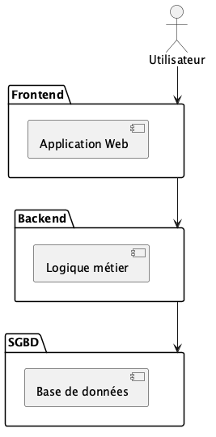 

# Conformité

## Collecte et Traitement des Données

L'application collecte les données personnelles suivantes 

- adresse mail
- pseudo
- alertes
- rappels
- enseignes
- marques
- produits

Ces données sont d'un intérêt légitimie pour l'application.

## Droits des Utilisateurs

Tout utilisateur a les droits suivants:

- droit d’accès pour consulter leurs données personnelles.;
- doit de rectification;
- droit à l’effacement : tout utilisateur peut effacer son compte à tout moment, depuis la page *Mon compte*; l'effacement de son compte et de toutes ses données est immédiat et définitif (voir [Suppression d'un utilisateur](#suppression-dun-utilisateur));
- droit à la portabilité : tout utilisateur peut demander l'export de ses données.

## Droits des enseignes et des marques

Les informations collectées sur les marques et les enseignes sont fournies en open data par le gouvernement français. Il conviendra de vérifier les implications du stockage par l'application.

## Sécurité et Protection des Données

- **chiffrement** : les données en transit entre le frontend et le backend sont chiffrées (TLS 1.3; X25519MLKEM768).
- **authentification et accès** : l'accès est réservé aux utilisateurs authentifiés et eux seuls
- **stockage et hébergement** : cloud OVH avec serveurs en France
- **logs et traçabilité** : les traces des accès sont conservées pendant un an

## Consentement et Cookies

    Bannière de consentement : si des cookies de suivi sont utilisés, ils doivent être acceptés explicitement par l’utilisateur.
    Gestion du consentement : permettre aux utilisateurs de modifier leurs préférences à tout moment.
    Politique de confidentialité : mise à disposition d’un document expliquant clairement le traitement des données.

## Sous-traitants et Partage des Données

    Liste des prestataires : préciser les tiers avec lesquels les données sont partagées (ex. : le prestataire d'envoi des emails d'alerte).
    Contrats de sous-traitance : s’assurer que chaque prestataire respecte le RGPD (ex. : DPA - Data Processing Agreement).
    Transfert hors UE : indiquer si les données sont transférées hors de l’UE et préciser les garanties mises en place (ex. : clauses contractuelles types).

## Durée de Conservation des Données

1. Les données d'un utilisateur sont conservées tant que son compte existe:

- toute suppression est immédiate et définitive: il n'y a pas de suppression logique (voir [Suppression de données](#suppression-de-données));
- la suppression du compte efface immédiatement le compte, les alertes, les emails d'alerte et leurs envois, les sessions et les jetons de connexion de l'utilisateur;
- les traces des accès sont conservées un an; elles ne contiennent pas l'adresse email;
- les jetons de connexion et les sessions sont effacés dès qu'ils ont expiré ou ont été utilisés;
- les sauvegardes de la base de données sont conservées 30 jours: les données d'un compte supprimé disparaissent de la base immédiatement, et des sauvegardes au plus 30 jours après (voir [Sauvegardes](#architecture-1)). La politique de confidentialité l'indique.

2. Les rappels sont gardés indéfiniment.

## Point de Contact et DPO

    Nom et contact du Délégué à la Protection des Données (DPO) si applicable.
    Canaux pour exercer ses droits (ex. : formulaire en ligne, email dédié).

# Sécurité

La sécurité de l'application est assurée en implémentant les bonnes pratiques recommandées par [OWASP - *Open Web Application Security Project*](https://owasp.org/). 

Voici une liste non exhaustive des pratiques suivies:

- **authentification par lien magique** : l'utilisateur saisit son adresse email et reçoit un email contenant un lien de connexion et un code à 6 chiffres (voir [Connexion par lien magique](#connexion-par-lien-magique)):
  - l'application ne stocke aucun mot de passe et ne dépend d'aucun fournisseur d'identité tiers;
  - le lien et le code sont tirés au hasard, utilisables une seule fois, et expirent 15 minutes après l'envoi; seule leur empreinte (*hash*) est stockée en base de données;
  - le lien ne connecte pas l'utilisateur à son ouverture: il ouvre une page avec un bouton « Se connecter », et c'est ce bouton qui connecte. Les filtres de sécurité des messageries, qui ouvrent les liens des emails pour les analyser, ne peuvent donc pas consommer le lien à la place de l'utilisateur;
  - le code à 6 chiffres permet de se connecter sur un autre appareil que celui où l'email est lu; le nombre d'essais est limité (ex: 5) pour empêcher de deviner le code;
  - le nombre de demandes de connexion est limité par adresse email et par adresse IP (ex: 3 par heure et par adresse email), pour que l'application ne puisse pas servir à inonder la boîte mail d'un tiers;
  - la réponse à une demande de connexion est toujours la même (« si l'adresse est valide, un email vous a été envoyé »), pour ne pas révéler quelles adresses ont un compte;
  - la sécurité du compte repose sur celle de la boîte mail de l'utilisateur; l'envoi des emails doit être fiable et rapide (prestataire d'envoi, SPF, DKIM, DMARC);
- **sessions** : une session expire 24 heures après la connexion, pour des raisons de sécurité; elle est portée par un cookie `HttpOnly`, `Secure` et `SameSite=Lax`; la déconnexion invalide la session;
- **administrateur** : la base de données ne contient aucune information permettant d'identifier l'administrateur, pour ne rien révéler en cas de fuite de la base:
  - l'adresse email de l'administrateur est stockée dans un secret local au backend (ex: variable d'environnement ou fichier de secrets du serveur), jamais dans la base de données ni dans le dépôt de code, et jamais écrite dans les traces;
  - après chaque connexion, le backend compare l'adresse email de l'utilisateur connecté à ce secret (comparaison insensible à la casse, en temps constant); si elles sont identiques, l'utilisateur est l'administrateur;
  - changer d'administrateur revient à modifier le secret local et à redémarrer le backend;
  - voir [Connexion d'un administrateur](#connexion-dun-administrateur);
- **autorisation** : l'application implémente les autorisations; elle sont décrites au chapitre [fonctionnalité](#fonctionnalités)
- **stockage des informations**: les informations sont stockées dans une DB non chiffrée.

# Fonctionnalités

L’application permet de gérer des alertes de rappels produit et les statistiques associées. Seuls les utilisateurs enregistrés (ayant créé un compte) peuvent utiliser l'application. Les fonctionnalités sont les suivantes:

1. Gestion des utilisateurs : les utilisateurs doivent se connecter pour intéragir avec l'application; le compte est créé automatiquement à la première connexion; c'est la seule action possible sans être préalablement enregistré;
2. Gestion des alertes: les utilisateurs peuvent configurer les alertes sur les rappels produit qu'ils souhaitent recevoir; les alertes sont envoyées par email;
3. Gestion des marques: les utilisateurs peuvent configurer et recevoir les alertes par marque;
4. Gestion des produits: les utilisateurs peuvent configurer et recevoir les alertes par produit;
5. Gestion des familles de produits: les utilisateurs peuvent configurer et recevoir les alertes par famille de produit;
6. Gestion des enseignes et des magasins: les utilisateurs peuvent configurer et recevoir les alertes par enseigne; dans cette première version, le magasin n'est pas un critère d'alerte: les magasins sont liés aux rappels pour l'affichage, les statistiques et la géographie par enseigne;
7. Gestion des lieux géographiques: les utilisateurs peuvent peuvent configurer et recevoir les alertes par lieu géographique;
8. Statistiques: les utilisateurs peuvent lire les statistiques produites par l'application. Les statistiques sont calculées au fur et à mesure des rappels produits.


## Gouvernance

Les informations stockées par l’application sont gérées selon des règles de gouvernance décrites dans ce chapitre. Ces règles définissent la création, l'accès, la propriété et la suppression des données fournies à l'application.

Les données se répartissent en deux catégories:

- les données communes (rappels, marques, produits, familles de produits, enseignes, magasins, référentiel géographique, statistiques) sont les mêmes pour tous et accessibles à tout utilisateur connecté; elles ne sont jamais accessibles sans connexion;
- les données personnelles (compte, alertes, emails d'alerte et envois, sessions, jetons de connexion) ne sont accessibles qu'à leur propriétaire.

Sans connexion, seules les pages publiques sont accessibles (accueil, connexion, pages légales). L'API ne répond alors qu'aux routes publiques: la connexion, le désabonnement par jeton et l'état de santé du service (`/api/sante`), qui indique seulement si le service fonctionne et ne renvoie aucune donnée.

### Gouvernance des utilisateurs

1. **Création** : tout utilisateur peut créer un compte;
2. **Propriété**: tout utilisateur possède son compte;
3. **Transfert de propriété**: il est impossible de transférer la propriété d'une fiche utilisateur;
4. **Lecture**: les fiches utilisateurs sont privées;
5. **Modification** : tout utilisateur peut modifier sa propre fiche;
6. **Suppression**: tout utilisateur peut supprimer son compte. Le compte et toutes les données de l'utilisateur sont alors effacés, immédiatement et définitivement.

### Gouvernance des alertes

1. **Création** : tout utilisateur peut créer des alertes;
2. **Propriété**: une alertes appartient au créateur de l'alerte;
4. **Lecture**: une alerte est accessible par son propriétaires;
5. **Modification** : une alerte peut être modifiée par son propriétaire;
6. **Transfert de propriété**: il est impossible de transférer la propriété d'une alerte;
6. **Suppression**: une alerte peut être supprimée par son propriétaire; elle est effacée immédiatement et définitivement.

### Gouvernance des marques

Les marques sont gérées par le backend, en fonction des rappels de produit détectés.

1. **Création** : le backend crée une marque lorsqu'un rappel cite un nom que la fusion de marques ne rattache à aucune marque connue (voir [Fusion de marques](#fusion-de-marques));
2. **Propriété**: les marques appartiennent au backend;
4. **Lecture**: les marques sont librement accessibles aux utilisateurs enregistrés;
5. **Modification** : la seule modification possible est la fusion d'une marque avec une marque déjà connue, décidée par l'IA de la fusion de marques ou par le Product Owner dans le fichier des décisions de fusion. Une fusion décidée par le Product Owner renseigne le lien `id_marque_cible` de la marque absorbée et ne modifie aucun rappel. Le nom d'une marque n'est jamais modifié;
6. **Transfert de propriété**: il est impossible de transférer la propriété d'une marque;
6. **Suppression**: seul l'administrateur peut supprimer une marque; l'effacement est immédiat et définitif, et s'étend aux marques qu'elle a absorbées (voir [Suppression de données](#suppression-de-données)).

### Gouvernance des produits

Les produits sont gérés par le backend, en fonction des rappels de produit détectés.

1. **Création** : le backend crée un produit lorsqu'un rappel cite pour la première fois son code-barres (GTIN); une fiche sans code-barres ne crée aucun produit (voir [Produits](#produits));
2. **Propriété**: les produits appartiennent au backend;
4. **Lecture**: les produits sont librement accessibles aux utilisateurs enregistrés;
5. **Modification** : un produit n'est jamais modifié après sa création;
6. **Transfert de propriété**: il est impossible de transférer la propriété d'un produit;
6. **Suppression**: seul l'administrateur peut supprimer un produit; l'effacement est immédiat et définitif (voir [Suppression de données](#suppression-de-données)).

### Gouvernance des familles de produit

Les familles de produits sont gérées par le backend, en fonction des rappels de produit détectés.

1. **Création** : le backend créé une famille de produit qui apparait pour la première fois dans un rappel produit;
2. **Propriété**: les familles de produits appartiennent au backend;
4. **Lecture**: les familles de produits sont librement accessibles aux utilisateurs enregistrés;
5. **Modification** : le backend peut modifier une famille de produits selon les informations contenues dans un rappel produit; cet évènement devrait être rare;
6. **Transfert de propriété**: il est impossible de transférer la propriété d'une famille de produits;
6. **Suppression**: seul l'administrateur peut supprimer une famille de produits; l'effacement est immédiat et définitif (voir [Suppression de données](#suppression-de-données)).

### Gouvernance des enseignes

Les enseignes forment une liste déclarée, avec leurs écritures (voir [Enseignes](#enseignes)).

1. **Création** : une enseigne et ses écritures sont ajoutées dans le fichier déclaré des enseignes, versionné avec le code et relu comme lui; la collecte ne crée jamais d'enseigne;
2. **Propriété**: les enseignes appartiennent au backend;
4. **Lecture**: les enseignes sont accessibles à tout utilisateur connecté;
5. **Modification** : uniquement par le fichier déclaré (ex: ajout d'une écriture signalée par la collecte);
6. **Transfert de propriété**: il est impossible de transférer la propriété d'une enseigne;
6. **Suppression**: uniquement par le fichier déclaré; l'administrateur ne peut pas supprimer une enseigne depuis l'application.

### Gouvernance des magasins

Les magasins sont gérés par le backend, en fonction des rappels de produit détectés.

1. **Création** : le backend crée un magasin lorsqu'un rappel le cite sans ambiguïté (voir [Interprétation des distributeurs](#interprétation-des-distributeurs));
2. **Propriété**: les magasins appartiennent au backend;
4. **Lecture**: les magasins sont librement accessibles aux utilisateurs enregistrés;
5. **Modification** : un magasin n'est jamais modifié après sa création;
6. **Transfert de propriété**: il est impossible de transférer la propriété d'un magasin;
6. **Suppression**: seul l'administrateur peut supprimer un magasin; l'effacement est immédiat et définitif (voir [Suppression de données](#suppression-de-données)).

### Gouvernance des rappels

Les rappels sont gérés par le backend. Seules les fiches nationales de l'open data RappelConso créent des rappels. Les pages de rappels des enseignes sont exclues de la V1 (voir [Sources des rappels](#sources-des-rappels)).

1. **Création** : le backend crée un rappel lorsqu'une fiche RappelConso nationale publiée à partir de la date de lancement du service apparaît pour la première fois, c'est-à-dire lorsque son numéro de fiche (`numero_fiche`) est encore inconnu. Une republication d'une fiche déjà connue n'est pas un nouveau rappel. Les fiches RAPEX sont ignorées (voir [Sources des rappels](#sources-des-rappels));
2. **Propriété**: les rappels appartiennent au backend;
3. **Lecture**: les rappels sont librement accessibles aux utilisateurs enregistrés;
4. **Modification** : un rappel n'est **jamais modifié** après sa création (*write once*), même lorsque sa fiche RappelConso est republiée. 
5. **Transfert de propriété**: il est impossible de transférer la propriété d'un rappel;
6. **Suppression**: seul l'administrateur peut supprimer un rappel. Si RappelConso republie ensuite la fiche, ou si elle a moins de 30 jours (marge de recouvrement), le rappel est recréé à la collecte suivante et les emails d'alerte repartent: c'est voulu, et l'administrateur en porte la responsabilité (voir [Suppression de données](#suppression-de-données)).

### Gouvernance du référentiel géographique

1. **Création et modification** : le backend charge les départements et les régions actuelles depuis le Code officiel géographique de l'INSEE (voir [Outils externes](#outils-externes)), et les met à jour à chaque nouvelle édition (annuelle). Les autres appellations de zone (anciennes régions, groupements, variantes d'écriture) sont maintenues dans un fichier versionné avec le code, chargé avec le référentiel;
2. **Propriété**: le référentiel géographique appartient au backend;
3. **Lecture**: le référentiel est accessible à tout utilisateur connecté;
4. **Suppression**: sans objet; aucun utilisateur, même l'administrateur, ne peut le modifier ni le supprimer depuis l'application.

### Gouvernance des statistiques

1. **Lecture**: les statistiques sont librement accessibles aux utilisateurs enregistrés;
2. **Création, modification et suppression**: sans objet, les statistiques ne sont pas stockées, elles sont calculées par le backend à partir des rappels et de leurs liens avec les produits, marques, familles de produits, enseignes et magasins. Les statistiques reflètent à tout moment le contenu de la base de données.

# Structures des données

L'application utilise une  base de données relationnelle, typiquement ```postgresql```; elle comprend différentes tables. Les sous chapitres suivants détaillent les structures de données. 

## Utilisateurs

La classe utilisateurs contient les informations relatives aux utilisateurs:

```
- int id_user     : requis ; automatique
- string email    : requis ; unique ; identifiant de l'utilisateur et adresse d'envoi des alertes
- string prenom   : facultatif
- string nom      : facultatif
- datetime desabonne_at : facultatif ; date du désabonnement des emails d'alerte ; vide si l'utilisateur reçoit les alertes
- string politique_risque : requis ; 'prudente' ou 'stricte' ; default 'prudente' ; voir [Correspondances incertaines](#correspondances-incertaines)
```

L'adresse email est vérifiée par construction: un compte n'est créé que lorsque l'utilisateur s'est connecté avec le lien ou le code reçu à cette adresse.

La table ne contient volontairement aucune colonne de rôle: l'administrateur est identifié par le backend, à partir d'un secret local (voir [Sécurité](#sécurité)).

## Marques

La classe marques contient les marques des produits rappelés, telles que les sources les écrivent. Une même marque peut être écrite de plusieurs façons (ex: « Bonne Maman® », « BONNE MAMAN », « Bonne Mamain »). Les écritures que la [fusion de marques](#fusion-de-marques) reconnaît comme une même marque ne forment qu'une seule marque.

```
- int id_marque           : requis ; automatique
- string nom              : requis ; nom tel qu'écrit par la première source qui l'a cité (ex: 'Bonne Maman®')
- string nom_normalise    : requis ; nom normalisé (ex: 'bonne maman')
- string cle_comparaison  : requis ; unique ; nom normalisé sans espaces (ex: 'bonnemaman'), voir ci-dessous
- string raison_sociale   : facultatif ; société titulaire de la marque, si la source l'indique
- int id_marque_cible     : facultatif ; marque qui a absorbé celle-ci lors d'une fusion décidée par le Product Owner ; vide si la marque n'a pas été absorbée
```

La **marque retenue** d'une marque est sa marque cible si elle en a une, sinon elle-même. Une marque cible n'a jamais elle-même de cible: si une marque cible est à son tour absorbée, les marques qui pointaient vers elle pointent vers la nouvelle cible.

### Fusion de marques

La **fusion de marques** est la chaîne qui reconnaît, à la collecte, qu'un nom de marque cité par un rappel désigne une marque déjà connue. Le nom cité est alors rattaché à cette marque; sinon, une nouvelle marque est créée. Les étapes sont appliquées dans l'ordre:

1. **Normalisation.** Le nom est normalisé (voir [Interprétation des textes libres](#interprétation-des-textes-libres)), puis ses espaces sont retirés pour former la **clé de comparaison**. Ainsi « Bonne Maman® », « BONNE MAMAN », « Bonne-Maman » et « bonnemaman » donnent tous « bonnemaman »; « 5 five » et « 5five » donnent « 5five »; « best jardin » et « bestjardin » donnent « bestjardin ». Deux noms de même clé désignent toujours la même marque.
2. **Noms proches.** Si la clé est inconnue, le nom est comparé aux noms proches déjà connus (ex: au plus 2 caractères de différence, ou un nom contenu dans l'autre). S'il n'a aucun nom proche, une nouvelle marque est créée.
3. **IA.** Une IA tranche les cas restants: pour chaque nom proche, elle indique par un score si les deux noms désignent la même marque. Au-dessus du seuil, les deux marques sont fusionnées: le nom cité est rattaché à la marque déjà connue. Le seuil initial est de 80 %; il est calibré sur un échantillon d'environ 200 paires de noms vérifiées à la main.
4. **Décisions enregistrées.** Chaque décision de l'IA est enregistrée (table ci-dessous) et n'est jamais recalculée: une paire de noms déjà jugée n'est plus soumise à l'IA.
5. **Décision du Product Owner.** Sous le seuil, le nom cité devient une nouvelle marque, et la paire est signalée au Product Owner. Il tranche dans un fichier de décisions de fusion, versionné avec le code et relu comme lui. Une fusion qu'il décide ne modifie aucun rappel: la nouvelle marque est conservée et reçoit un lien vers la marque déjà connue (`id_marque_cible`).

Le critère *marque* d'une alerte, les filtres et les statistiques portent sur la **marque retenue**: ils suivent le lien `id_marque_cible`. Une alerte qui cite une marque absorbée reçoit donc aussi les rappels de la marque qui l'a absorbée, et inversement.

Décisions de fusion de l'IA:

```
- int id_decision        : requis ; automatique
- string cle_nom         : requis ; clé de comparaison du nom cité (ex: 'bonnemamain')
- int id_marque          : requis ; ref sur la marque déjà connue à laquelle le nom a été comparé
- int score              : requis ; score donné par l'IA, de 0 à 100
- boolean fusion         : requis ; vrai si le score atteint le seuil
- string justification   : requis ; justification donnée par l'IA
- string version_modele  : requis ; modèle d'IA et sa version
- datetime date_decision : requis
  unicité : (cle_nom, id_marque)
```

Les données envoyées à l'IA sont des données publiques, issues des rappels (noms de marque): elles ne contiennent **aucune donnée personnelle**.

**Choix de l'IA.** L'IA utilisée est déterminée par la configuration: son jeton d'accès est fourni par une variable d'environnement (ex: `OPENAI_API_TOKEN`). Ce jeton est un secret: il n'est jamais dans le dépôt, dans la base de données ni dans les traces.

Sans jeton *IA*, l'étape IA n'est pas executée.

**Fusion décidée après coup.** Une fusion décidée par le Product Owner après la collecte d'un rappel n'envoie aucune alerte pour les rappels déjà collectés: ils ne sont pas comparés de nouveau aux alertes. La fusion ne vaut, pour l'envoi des alertes, que pour les rappels collectés ensuite (voir [Envoi des alertes](#envoi-des-alertes)); elle vaut immédiatement pour les filtres et les statistiques.

**Suppression d'une marque fusionnée.** Supprimer une marque supprime aussi les marques qu'elle a absorbées (liées à elle par `id_marque_cible`). Pour chacune, la règle générale s'applique: les rappels perdent leur marque, le critère *marque* des alertes est retiré, et une alerte qui n'a plus aucun critère est effacée (voir [Suppression de données](#suppression-de-données)).

## Produits

La classe produits contient les produits rappelés, identifiés par leur code-barres (GTIN). **Un produit est un code-barres.**

```
- int id_produit  : requis ; automatique
- string gtin     : requis ; unique ; code-barres du produit
- int id_famille  : requis ; identifiant de la famille de produit, celle de la fiche qui l'a cité en premier
- string nom      : requis ; description du produit dans la fiche qui l'a cité en premier (champ « modèles ou références »)
```

Une fiche RappelConso donne une seule marque, une seule description de produit et de zéro à plusieurs codes-barres. Le modèle suit donc la fiche:

- la **marque** est portée par le rappel (champ `id_marque` des [rappels](#rappels)), pas par le produit;
- une fiche crée un produit par code-barres; une fiche à plusieurs codes-barres crée plusieurs produits, qui ont le même nom;
- une fiche **sans code-barres** ne crée aucun produit: le rappel garde sa marque, sa famille et sa description, et peut être reçu par les critères marque, famille, enseigne et code postal, mais pas par le critère produit. Cela concerne environ 4 fiches sur 10 (39 % des fiches nationales publiées de juillet 2024 à octobre 2026 n'ont aucun code-barres valide).

**Code-barres valide.** Le champ d'identification des produits de RappelConso mélange codes-barres, numéros de lot, types de date (« date limite de consommation ») et dates: dans les fiches nationales de juillet 2024 à octobre 2026, seule une valeur sur dix est un code-barres. Une valeur ne crée un produit que si:

- elle ne contient que des chiffres, au nombre de 8, 12, 13 ou 14;
- sa clé de contrôle GS1 est correcte;
- ce n'est pas un code interne à un magasin (code de 13 chiffres commençant par « 2 », ou de 14 chiffres dont le deuxième chiffre est « 2 », ex: produits vendus au poids): un tel code ne désigne pas le même produit d'une enseigne à l'autre.

Les autres valeurs ne créent rien: elles sont conservées, telles que publiées, dans le champ `lots` du rappel.

Exemple: une fiche « Bonne Maman », « confiture fraise 370 g et 750 g », avec deux codes-barres, crée un rappel de marque Bonne Maman et deux produits nommés « confiture fraise 370 g et 750 g ».

## Familles de produits

La classe familles de produits contient les informations relatives aux familles de  produits: nom, code barre etc. Ces informations sont celles contenues dans un rappel produit, le cas échéant.

```
- int id_famille        : requis ; automatique
- string nom            : requis
- int id_famille_parent : facultatif ; famille parente
```

Les familles de produits sont organisées en deux niveaux, comme dans RappelConso: une catégorie (ex: alimentation) et ses sous-catégories (ex: produits laitiers). Une sous-catégorie a pour parent sa catégorie; une catégorie n'a pas de parent.

## Enseignes

La classe enseignes contient les informations relatives aux enseignes (ex: Carrefour, E.Leclerc, Auchan).

```
- int id_enseigne    : requis ; automatique
- string nom         : requis ; nom de référence (ex: 'E.Leclerc')
```

Les enseignes forment une **liste déclarée**: elles sont décrites dans un fichier versionné avec le code, avec toutes leurs écritures, et ne sont jamais créées par la collecte (voir [Gouvernance des enseignes](#gouvernance-des-enseignes)). Sinon, les producteurs et commerces cités dans les rappels (« fromagerie pauly », « saisonniers ») deviendraient des enseignes.

### Écritures d'enseigne

Les écritures d'enseigne sont une table de correspondance du fichier déclaré des enseignes: chaque écriture, normalisée, désigne une enseigne (ex: « cooperative u », « super u », « u express » → U). Elle est chargée avec le fichier déclaré; ce n'est pas une donnée gérée dans l'application. Les formats de magasin sont des écritures de leur enseigne: une alerte « Carrefour » couvre aussi Carrefour Market et Carrefour City.

```
- string nom_normalise : requis ; unique ; ex: 'e leclerc', 'centre e leclerc', 'leclerc', 'cooperative u', 'super u', 'u express', 'carrefour market', 'carrefour hypermarche'
- int id_enseigne      : requis ; ref enseigne
```

## Magasins

La classe magasins contient les informations relatives aux magasins. Un magasin appartient à une enseigne; une enseigne a de zéro à plusieurs magasins. Un rappel produit peut ne concerner que certains magasins d'une enseigne. Les magasins sont créés par la collecte, lorsqu'un rappel cite un magasin reconnu sans ambiguïté (voir [Interprétation des distributeurs](#interprétation-des-distributeurs)).

```
- int id_magasin          : requis ; automatique
- int id_enseigne         : requis ; enseigne du magasin
- string nom              : requis ; nom tel qu'écrit par la source (ex: 'Carrefour hypermarché Ermont')
- string nom_normalise    : requis ; ex: 'carrefour hypermarche ermont'
- string adresse          : facultatif
- string code_postal      : requis
- string ville            : requis
- string code_departement : requis ; ref département
  unicité : (id_enseigne, nom_normalise)
```

## Alertes

Tout utilisateur peut créer des alertes; il y a une relation est de type 1 à N: un utilisateur peut avoir de zéro à plusieurs alertes. Une alerte a les données suivantes: date, produit, marque, enseigne

```
- int id_alerte      : requis ; automatique
- int id_user        : requis ; utilisateur propriétaire de l'alerte
- int id_enseigne    : facultatif ; ref sur l'enseigne
- int id_marque      : facultatif ; ref sur la marque
- int id_famille     : facultatif ; ref sur la famille de produit
- int id_produit     : facultatif ; ref sur le produit
- string code_postal : facultatif ; code postal pour filtre géographique ; ses départements sont dans la table alertes départements
- string combinaison : requis ; 'ET' ou 'OU' ; default 'OU'
- datetime date_configuration : requis ; date de création ou de dernière modification de l'alerte ; seuls les rappels collectés après cette date lui sont signalés (voir [Envoi des alertes](#envoi-des-alertes))
```

Dans cette première version, le magasin n'est pas un critère d'alerte.

Une alerte comporte au moins un critère. Le champ `combinaison` indique comment les critères renseignés sont combinés:

- `ET` : un rappel déclenche l'alerte si **tous** les critères renseignés correspondent (ex: marque X **et** enseigne Carrefour);
- `OU` : un rappel déclenche l'alerte si **au moins un** des critères renseignés correspond.

Les critères marque, produit, famille de produit et enseigne ne peuvent désigner que des données déjà connues de l'application, c'est-à-dire apparues dans au moins un rappel (voir [Gestion des risques](#gestion-des-risques)).

### Alertes départements

Cette table fait le lien entre une alerte et les départements de son code postal.

```
- int id_alerte           : requis ; ref alerte
- string code_departement : requis ; ref département
  unicité : (id_alerte, code_departement)
```

Les départements sont déduits du code postal à l'enregistrement de l'alerte, grâce à la base officielle des codes postaux (voir [Outils externes](#outils-externes)): le préfixe du code postal ne suffit pas (ex: Corse, outre-mer, communes dont le code postal relève d'un département voisin). Un code postal qui couvre plusieurs départements les couvre tous: l'alerte est liée à chacun d'eux. Cela concerne 16 codes postaux sur 6 328 dans la base officielle des codes postaux: 01200, 01410, 01590, 05110, 05130, 05160, 05700, 06260, 13780, 21340, 33220, 37160, 42620, 43450, 48250, 52100.

## Rappels

La classe rappels contient les informations relatives aux rappels produit. Un rappel est publié à une date, pour un motif, et concerne un  produit ou une famille de produits (e.g "Viandes et préparations de viande ficelées"). Ses champs reprennent ceux de RappelConso, la seule source qui crée des rappels (voir [Sources des rappels](#sources-des-rappels)).

```
- int id_rappel             : requis ; automatique
- string numero_fiche       : requis ; unique ; numéro de la fiche RappelConso (jamais son id, voir [Sources des rappels](#sources-des-rappels))
- datetime date_collecte    : requis ; date de la collecte qui a créé le rappel
- date date_publication     : requis ; date de publication de la fiche lue à la création du rappel (une republication la change dans RappelConso, pas dans le rappel)
- date date_fin_procedure   : facultatif ; fin de la procédure de rappel ou de l'affichage, si elle est connue à la création du rappel
- string titre              : requis
- string description_produit : facultatif ; description du produit telle que publiée (champ « modèles ou références »), texte libre
- int id_marque             : facultatif ; ref sur la marque de la fiche, après [fusion de marques](#fusion-de-marques)
- int id_famille            : facultatif ; ref sur la famille de produit
- string motif              : requis ; motif du rappel (ex: présence de Listeria)
- string risques            : facultatif ; risques encourus par le consommateur
- string conduite_a_tenir   : facultatif ; ce que doit faire le consommateur
- string lots               : facultatif ; identification des lots (n° de lot, DDM, DLC…) : valeurs du champ d'identification qui ne sont pas des codes-barres valides (voir [Produits](#produits)), texte libre
- string zone_geographique  : facultatif ; zone de vente, texte libre
- boolean zone_incertaine   : requis ; vrai si la zone de vente est absente ou n'a pas pu être interprétée ; fixé à la création
- string distributeurs      : facultatif ; liste des distributeurs telle que publiée, texte libre
- boolean toutes_enseignes  : requis ; vrai si les distributeurs contiennent une formule « toutes enseignes » : le rappel concerne alors toutes les enseignes (voir [Interprétation des distributeurs](#interprétation-des-distributeurs)) ; fixé à la création
- string url_fiche          : facultatif ; lien vers la fiche officielle
```

### Interprétation des textes libres

En règle générale, les champs des rappels sont des **textes libres**, écrits différemment d'une source et d'un rappel à l'autre. Leur interprétation suit des principes communs:

1. **le texte d'origine est toujours conservé** et affiché tel quel, comme du texte;
2. des liens structurés (départements, enseignes, magasins) n'en sont tirés que par des **règles exactes**: normalisation, référentiels officiels et fichiers déclarés (écritures d'enseigne, appellations de zone), versionnés avec le code;
3. **aucun rapprochement approché automatique**: un élément qui ne correspond exactement à rien n'est rattaché à rien. Seuls les noms de marque font exception: ils suivent la [fusion de marques](#fusion-de-marques) (noms proches, IA, décision du Product Owner);
4. tout élément non reconnu est **signalé** (traces de la collecte), pour que le Product Owner complète les fichiers déclarés;
5. en cas de doute sur la zone de vente, on retient **l'interprétation qui prévient le plus**: « France entière ». Mieux vaut un email de trop qu'un rappel manqué. Le rappel est alors marqué comme incertain (`zone_incertaine`), et chaque utilisateur choisit s'il veut recevoir ces rappels (voir [Correspondances incertaines](#correspondances-incertaines)). Les distributeurs ne suivent pas cette règle: un rappel dont aucune enseigne n'est reconnue n'a pas d'enseigne, sauf s'il cite une formule « toutes enseignes » (voir [Interprétation des distributeurs](#interprétation-des-distributeurs)).

**Normalisation.** Tous les textes comparés le sont après la même normalisation: forme Unicode NFKC; suppression des symboles ®, ™, © et ℗; minuscules; accents retirés; « & » remplacé par « et »; ponctuation, apostrophes et tirets remplacés par des espaces; espaces multiples réduits à un seul; espaces de début et de fin retirés (ex: « Île-de-France » → « ile de france », « Carrefour Hypermarché » → « carrefour hypermarche »). Pour les noms de marque, la clé de comparaison ignore en outre les espaces (voir [Fusion de marques](#fusion-de-marques)).

Champs interprétés: `zone_geographique` (voir [Rappels départements](#rappels-départements)), `distributeurs` (voir [Interprétation des distributeurs](#interprétation-des-distributeurs)) et le nom de la marque (voir [Fusion de marques](#fusion-de-marques)). Les autres champs (`motif`, `risques`, `conduite_a_tenir`, `lots`…) sont conservés et affichés sans interprétation.

### Interprétation des distributeurs

Le champ `distributeurs` est une liste en texte libre qui mélange enseignes, magasins précis, producteurs et formules générales. Il est interprété ainsi:

1. le texte est découpé en éléments: virgules, points-virgules, « ¤ », « / », retours à la ligne;
2. chaque élément est normalisé, et les mots ignorés déclarés (ex: « uniquement », « seulement », « magasin », « magasins ») en sont retirés;
3. si l'élément est une **formule « toutes enseignes »** (comparée avant le retrait des mots ignorés: sinon « tous magasins » deviendrait « tous »), le rappel concerne **toutes les enseignes** (`toutes_enseignes` est vrai). Ces formules forment une liste déclarée, versionnée avec le code et comparée après normalisation, comme les écritures d'enseigne (ex: « toutes enseignes », « toutes les enseignes », « tous distributeurs », « tous magasins »). Une formule qui n'y figure pas (ex: « gms ») reste une formule générale: elle n'est rattachée à rien;
4. sinon, on cherche la **plus longue [écriture d'enseigne](#écritures-denseigne)** par laquelle l'élément **commence** (mots entiers):
   - aucune: l'élément n'est rattaché à rien et il est signalé (producteur, commerce indépendant, formule générale);
   - une écriture, sans reste: l'enseigne est liée au rappel;
   - une écriture suivie d'un reste: l'enseigne est liée au rappel; si le reste est le nom d'une commune identifiée sans ambiguïté dans la base officielle des codes postaux (au besoin parmi les départements du rappel), le magasin de cette enseigne dans cette commune est lié au rappel, et créé s'il n'existe pas. Sinon, seule l'enseigne est liée et le reste est signalé;
5. si le rappel cite une formule « toutes enseignes », il **correspond à tout critère *enseigne***, quelle que soit l'enseigne de l'alerte (voir [Envoi des alertes](#envoi-des-alertes)). Les enseignes et magasins cités par ailleurs dans le champ sont liés comme ci-dessus;
6. si **aucune enseigne** n'est liée et que le rappel ne cite pas de formule « toutes enseignes » (champ vide, formule générale comme « gms » ou « voir pièce jointe », ou aucune enseigne reconnue), le rappel **n'a pas d'enseigne**. Il ne correspond à aucun critère *enseigne*: il ne peut être reçu que par un autre critère (marque, produit, famille, code postal). C'est le cas d'environ la moitié des fiches (51 % des 6 767 fiches nationales publiées de juillet 2024 à octobre 2026, avec une liste de 80 enseignes; la proportion dépend de la liste déclarée), voir [Gestion des risques](#gestion-des-risques). Les formules « toutes enseignes » ne concernent que 5 de ces fiches.

Exemples:

| Texte du champ `distributeurs` | Enseignes liées | Magasins liés | Éléments signalés |
|---|---|---|---|
| carrefour hypermarché ermont uniquement | Carrefour | Carrefour Ermont (95) | — |
| carrefour | Carrefour | — | — |
| saff¤soudry sas¤ferme fontaine¤fromagerie de romain¤leclerc fecamp¤coopérative u¤saisonniers¤carrefour gruchet¤netto bolbec¤intermarché fecamp¤fromagerie pauly¤2 airelles¤nsf¤magasin des 5 frères¤ | E.Leclerc, U, Carrefour, Netto, Intermarché | E.Leclerc Fécamp, Netto Bolbec, Intermarché Fécamp | saff, soudry sas, ferme fontaine, fromagerie de romain, saisonniers, fromagerie pauly, 2 airelles, nsf, des 5 frères, et « gruchet » (deux communes possibles: Gruchet-le-Valasse, Gruchet-Saint-Siméon) |
| toutes enseignes | toutes (`toutes_enseignes` vrai) | — | — |
| toute enseigne distribuant la marque auchan | aucune: le rappel **n'a pas d'enseigne** | — | toute enseigne distribuant la marque auchan |

Le dernier exemple montre pourquoi l'écriture d'enseigne doit être en **début** d'élément: « auchan » y désigne une marque de distributeur, pas l'enseigne qui vend le produit.

## Sources des rappels

Dans cette première version, une seule source crée des rappels: les fiches nationales de l'open data RappelConso (jeu de données `rappelconso-v2-gtin-espaces`, voir [Outils externes](#outils-externes)). 

**Identification d'un rappel.** Un rappel est identifié dans RappelConso par son numéro de fiche (`numero_fiche`), jamais par son identifiant (`id`): une republication de la fiche (`numero_version` incrémenté) change son `id` et sa `date_publication`. Une republication d'une fiche déjà connue n'est pas un nouveau rappel et ne déclenche aucune alerte. Les nouveaux rappels ne sont jamais détectés par leur `date_publication`: est nouveau un rappel dont le numéro de fiche est encore inconnu. Le numéro de fiche commence par l'année et le mois de sa première publication (ex: `2026-03-0268`).

**Date de lancement.** Les fiches publiées avant la date de lancement du service (paramètre de configuration) ne sont jamais lues: CADI ne reprend pas l'historique de RappelConso. Une fiche publiée avant la date de lancement et republiée après a un numéro inconnu de CADI: elle crée un rappel et déclenche les alertes, comme une fiche nouvelle. C'est voulu: le rappel est toujours en cours, et mieux vaut un email de trop qu'un rappel manqué. Le détail du rappel et l'email indiquent alors le mois de première publication, lu dans le numéro de fiche (ex: « publié initialement en mars 2026 »).

**Lecture.** RappelConso est lu par l'API Explore v2.1 de data.economie.gouv.fr (voir [Outils externes](#outils-externes)). Cette API refuse toute page au-delà de la 10 000ᵉ fiche d'une requête (`offset + limit ≤ 10 000`), alors que le jeu de données en compte plus de 19 000. Chaque collecte ne lit donc que les fiches dont la `date_publication` est postérieure au début de la dernière collecte réussie, moins une **marge de recouvrement de 30 jours** (paramètre de configuration), et jamais antérieure à la date de lancement; elle les lit page par page. La marge rattrape les fiches qui arrivent dans l'open data après leur date de publication (retard de mise à jour, panne): sans elle, une telle fiche serait perdue. Elle fait relire environ 250 fiches déjà connues à chaque collecte: elles sont ignorées grâce à leur numéro. En contrepartie, un rappel supprimé par l'administrateur dont la fiche a moins de 30 jours est recréé dès la collecte suivante (voir [Suppression de données](#suppression-de-données)).

**Fiches RAPEX exclues.** Les fiches RAPEX (système d'alerte rapide européen) sont exclues de cette première version: la collecte les ignore. Elles se reconnaissent ainsi: `numero_version` égal à 0, numéro de fiche au format « sr/… » (ou « or/… »), URL de fiche contenant « /rapex ». Environ 1 000 fiches par an ne sont donc pas couvertes (voir [Gestion des risques](#gestion-des-risques)). Une fiche est exclue dès qu'un de ces signes est présent.

**Pages de rappels des enseignes exclues.** Les pages de rappels publiées par les enseignes ne sont pas lues dans cette première version.

Avec une seule source, il n'y a pas de table des sources: chaque rappel garde le numéro de sa fiche (`numero_fiche`, unique) et la date de sa collecte (voir [Rappels](#rappels)). C'est ce numéro qui permet de ne lire qu'une fois chaque fiche lors de la collecte.

## Collectes

La classe collectes garde l'état de chaque collecte, pour que le backend sache, après un arrêt ou une erreur, où il en était (voir [Collecte des rappels](#collecte-des-rappels)).

```
- int id_collecte          : requis ; automatique
- datetime date_debut      : requis ; début de la collecte
- datetime date_fin        : facultatif ; fin de la collecte ; vide tant qu'elle n'est pas terminée
- string statut            : requis ; 'en cours', 'réussie' ou 'échouée'
- int nb_fiches_lues       : requis ; default 0
- int nb_rappels_crees     : requis ; default 0
```

La prochaine collecte lit les fiches à partir du début de la dernière collecte réussie (moins la marge de recouvrement), ou de la date de lancement s'il n'y en a pas encore.

### Rappels à traiter

Cette table contient les rappels créés mais pas encore comparés aux alertes. Un rappel y est ajouté dans la même transaction que sa création; il en est retiré dans la même transaction que l'enregistrement des emails d'alerte et des envois qu'il produit. Après un arrêt du backend entre la création d'un rappel et l'envoi des alertes, le rappel reste donc à traiter, et la collecte suivante l'envoie: aucun rappel n'échappe aux alertes. La table `rappels` reste ainsi écrite une seule fois.

```
- int id_rappel : requis ; unique ; ref rappel
```

## Liens entre les rappels et les autres données

Un rappel concerne un ou plusieurs produits, enseignes ou magasins, et inversement: ce sont des relations de type N à N, stockées dans des tables de liaison. Ces relations sont stockées dans quatre tables de liaisons.

### Rappels produits

Cette table fait le lien entre un rappel et un produit.

```
- int id_rappel  : requis ; ref rappel
- int id_produit : requis ; ref produit
```

### Rappels enseignes

Cette table fait le lien entre un rappel et une enseigne. Un rappel « toutes enseignes » n'y a pas une ligne par enseigne: il est marqué par son champ `toutes_enseignes` (voir [Rappels](#rappels)).

```
- int id_rappel   : requis ; ref rappel
- int id_enseigne : requis ; ref enseigne
```

### Rappels magasin

Cette table fait le lien entre un rappel et un magasin.

```
- int id_rappel  : requis ; ref rappel
- int id_magasin : requis ; ref magasin
```

La marque d'un rappel est celle de sa fiche (champ `id_marque` du rappel), pas celle de ses produits. La table `rappels_magasins` n'est renseignée que lorsque le rappel cite des magasins précis.

### Rappels départements

Cette table fait le lien entre un rappel et les départements de sa zone de vente.

```
- int id_rappel           : requis ; ref rappel
- string code_departement : requis ; ref département (ex: '75', '2A', '971')
  unicité : (id_rappel, code_departement)
```

Elle est renseignée à la création du rappel, en interprétant le champ `zone_geographique`, à l'aide du [référentiel géographique](#référentiel-géographique). Le texte d'origine reste conservé dans `zone_geographique`. Une zone désigne souvent une région (ex: « Nouvelle-Aquitaine », « Île-de-France », « Occitanie »): elle est alors remplacée par tous ses départements.

Interprétation d'une zone de vente:

1. le texte est normalisé (voir [Interprétation des textes libres](#interprétation-des-textes-libres)), ex: « Île-de-France » → « ile de france »;
2. il est découpé en éléments (virgules, points-virgules, « et », retours à la ligne);
3. chaque élément est reconnu comme:
   - « France entière » (ou une variante: « toute la France », « national »): le rappel concerne la France entière, aucun département n'est lié;
   - un code de département (ex: « 67 », « 2A », « 971 ») ou un nom de département (ex: « Bas-Rhin »): ce département est lié;
   - une [appellation de zone](#appellations-de-zone) (région actuelle, ancienne région, groupement comme « France métropolitaine » ou « Outre-mer »): tous ses départements sont liés;
4. si un seul élément n'est pas reconnu, la zone entière est considérée comme impossible à interpréter: aucun département n'est lié, le rappel reste en « France entière » et `zone_incertaine` est vrai (de même si la zone est absente). Une zone explicitement « France entière » n'est pas incertaine. L'élément inconnu est enregistré dans les traces, pour compléter les appellations de zone.

La zone de vente d'un rappel est **France entière** lorsqu'aucun département ne lui est lié. C'est le cas par défaut: une zone de vente absente ou impossible à interpréter laisse le rappel en « France entière » (mieux vaut un email de trop qu'un rappel manqué). « France entière » ne dépend que de la zone de vente: un magasin lié au rappel ne la supprime pas (voir [Géographie par enseigne](#géographie-par-enseigne)). Cette information est déduite des liens et n'est pas stockée dans le rappel, qui n'est jamais modifié.

### Géographie par enseigne

Un rappel ne concerne pas forcément ses enseignes sur la même zone. La géographie de chaque enseigne d'un rappel est déduite de ses liens:

- une enseigne citée seule dans les distributeurs prend la zone de vente du rappel (départements liés, ou France entière), même si certains de ses magasins sont aussi cités: « carrefour, carrefour ermont » lie l'enseigne Carrefour, qui prend la zone de vente, et le magasin Carrefour d'Ermont;
- dans un rappel « toutes enseignes », toutes les enseignes prennent la zone de vente du rappel, y compris celles citées par leurs magasins: « toutes enseignes, leclerc fecamp » concerne toutes les enseignes sur la zone de vente, et lie en plus le magasin E.Leclerc de Fécamp;
- sinon, une enseigne citée uniquement par des magasins prend la zone de ces magasins (leurs départements).

Les magasins cités restent liés au rappel dans tous les cas: ils servent à l'affichage et aux statistiques par magasin.

La **géographie du rappel** est la réunion des géographies de ses enseignes, ou sa zone de vente s'il ne cite aucune enseigne; un rappel « toutes enseignes » comprend donc toujours sa zone de vente. Elle sert à l'affichage, aux statistiques et à l'[envoi des alertes](#envoi-des-alertes).

Exemple: zone de vente « France entière », distributeurs « carrefour, leclerc fecamp ». Carrefour est cité seul: il prend la France entière. E.Leclerc n'est cité que par son magasin de Fécamp: il prend la Seine-Maritime (76).

| Alerte (combinaison ET) | Reçoit le rappel ? |
|---|---|
| Carrefour ET 67 | oui: Carrefour est concerné dans toute la France |
| Leclerc ET 67 | non: E.Leclerc n'est concerné que dans le 76 |
| marque X (marque du produit rappelé) ET 67 | oui: la géographie du rappel comprend la France entière |

Si la zone de vente est « 68 », Carrefour prend le 68 et E.Leclerc le 76: « marque X ET 67 » ne reçoit pas le rappel.

## Référentiel géographique

Le référentiel géographique permet de passer d'un code postal, d'un nom de département ou d'une région aux départements concernés. Contrairement aux autres données de référence, il n'est pas créé à partir des rappels: il est chargé depuis des sources officielles (voir [Gouvernance du référentiel géographique](#gouvernance-du-référentiel-géographique)).

### Départements

```
- string code_departement : requis ; unique ; code officiel (ex: '01', '2A', '75', '971')
- string nom              : requis ; ex: 'Bas-Rhin'
- string nom_normalise    : requis ; unique ; nom normalisé pour la recherche (ex: 'bas rhin')
```

### Appellations de zone

Une appellation de zone est un nom qui désigne un ensemble de départements: une région actuelle (ex: « Nouvelle-Aquitaine »), une ancienne région d'avant 2016 encore utilisée par les sources (ex: « Midi-Pyrénées », « Alsace »), ou un groupement (ex: « France métropolitaine », « Outre-mer »).

```
- int id_zone          : requis ; automatique
- string nom           : requis ; ex: 'Nouvelle-Aquitaine'
- string nom_normalise : requis ; unique ; ex: 'nouvelle aquitaine'
- string type          : requis ; 'région', 'ancienne région' ou 'groupement'
```

### Zones départements

Cette table fait le lien entre une appellation de zone et ses départements.

```
- int id_zone             : requis ; ref appellation de zone
- string code_departement : requis ; ref département
  unicité : (id_zone, code_departement)
```

## Emails d'alerte

La classe emails d'alerte contient les emails adressés aux utilisateurs à l'issue d'une collecte. Un utilisateur reçoit **au plus un email d'alerte par collecte**, qui regroupe tous les nouveaux rappels correspondant à au moins une de ses alertes (voir [Envoi des alertes](#envoi-des-alertes)).

```
- int id_email                      : requis ; automatique
- int id_user                       : requis ; destinataire
- datetime date_creation            : requis ; fin de la collecte qui a produit l'email
- string statut                     : requis ; 'à envoyer', 'envoyé' ou 'abandonné' ; default 'à envoyer'
- int nb_tentatives                 : requis ; default 0
- datetime date_prochaine_tentative : facultatif ; vide si aucune tentative n'est prévue
- datetime date_envoi               : facultatif ; date de l'envoi réussi
- string derniere_erreur            : facultatif ; cause du dernier échec, sans donnée personnelle
- string empreinte_desabonnement    : requis ; empreinte (hash) du jeton du lien de désabonnement
```

## Envois

La classe envois indique, pour chaque email d'alerte, les rappels qu'il contient et les alertes qui les ont fait correspondre. Elle évite de signaler deux fois un même rappel pour une même alerte et sert de preuve d'envoi.

```
- int id_email  : requis ; ref email d'alerte
- int id_alerte : requis ; ref alerte
- int id_rappel : requis ; ref rappel
- boolean incertain : requis ; vrai si la correspondance est incertaine (voir [Correspondances incertaines](#correspondances-incertaines))
  unicité : (id_alerte, id_rappel)
```

## Jetons de connexion

La classe jetons de connexion contient les demandes de connexion par lien magique en cours. Un jeton correspond à un email envoyé, qui contient à la fois un lien et un code à 6 chiffres.

```
- int id_jeton           : requis ; automatique
- string email           : requis ; adresse qui a demandé la connexion
- string empreinte_lien  : requis ; empreinte (hash) du lien
- string empreinte_code  : requis ; empreinte (hash) du code à 6 chiffres
- datetime date_creation : requis
- datetime date_expiration : requis ; date_creation + 15 minutes
- int essais_code        : requis ; default 0 ; nombre de codes erronés saisis
- boolean utilise        : requis ; default 'false'
```

Utiliser le lien ou le code rend le jeton inutilisable. Les jetons expirés ou utilisés sont effacés par la [purge](#purge-des-données-expirées).

## Sessions

La classe sessions contient les sessions ouvertes par les utilisateurs connectés.

```
- int id_session           : requis ; automatique
- int id_user              : requis ; ref utilisateur
- string empreinte_session : requis ; empreinte (hash) de l'identifiant de session porté par le cookie
- datetime date_creation   : requis
- datetime date_expiration : requis ; date_creation + 24 heures
```

Une session est effacée à la déconnexion. Les sessions expirées sont effacées par la [purge](#purge-des-données-expirées).

## Statistiques

Les statistiques ne sont pas stockées: elles sont calculées à partir des rappels et de leurs liens, par exemple le nombre de rappels par enseigne, magasin, marque, produit, famille de produit ou zone géographique, et par période (mois, année).

Par zone géographique, un rappel compte pour chaque département de sa géographie (voir [Géographie par enseigne](#géographie-par-enseigne)); un rappel national (France entière) compte donc pour chaque département. Les totaux par département ne s'additionnent pas pour donner le total national.

Par enseigne, un rappel « toutes enseignes » compte pour chaque enseigne de la liste déclarée, comme un rappel national compte pour chaque département: les totaux par enseigne ne s'additionnent pas. Un rappel sans enseigne ne compte pour aucune enseigne.

# Workflow

Les workflows réspectent la [gouvernance](#gouvernance). Ce chapitre décrit les actions possibles, qu'elles soient déclenchées par un utilisateur, par un administrateur ou par le backend.

## Suppression de données

Toute suppression est **immédiate et définitive**: la donnée est effacée de la base de données. Il n'y a pas de suppression logique.

- **compte utilisateur** : effacement du compte, de ses alertes, de ses emails d'alerte et de leurs envois, de ses sessions et de ses jetons de connexion;
- **alerte** : effacement de l'alerte, de ses liens avec les départements et de ses envois;
- **donnée de référence** (par l'administrateur) : effacement de la donnée et de ses liens avec les rappels. Les références facultatives vers elle sont vidées (ex: un rappel perd sa marque, un critère d'alerte est retiré); les données qui en dépendent obligatoirement sont effacées avec elle (ex: les produits d'une famille, les marques absorbées par une marque, voir [Fusion de marques](#fusion-de-marques)). Une alerte qui n'a plus aucun critère est effacée;
- **rappel** (par l'administrateur) : effacement du rappel, de ses liens et des envois qui le citent. L'effacement sert à retirer une erreur de lecture, pas à masquer un rappel publié. Comme la collecte ne relit que les fiches récentes, le rappel n'est recréé que si RappelConso republie la fiche, ou si elle a moins de 30 jours (marge de recouvrement de la collecte, voir [Sources des rappels](#sources-des-rappels)): il revient alors comme un nouveau rappel, et les emails d'alerte repartent. C'est voulu: l'administrateur en porte la responsabilité.

Toute suppression faite par l'administrateur est écrite dans les traces: date, type et identifiant de la donnée effacée. L'auteur y est noté « administrateur », jamais son adresse email ni son identifiant d'utilisateur.

## Workflows des utilisateurs

### Connexion par lien magique

Tout utilisateur doit se connecter pour utiliser l'application. La connexion et la création de compte sont un seul et même workflow: le compte est créé à la première connexion réussie.

1. L'utilisateur saisit son adresse email.
2. Si le nombre de demandes autorisé n'est pas dépassé, l'application crée un jeton de connexion et envoie un email contenant un lien et un code à 6 chiffres. Dans tous les cas, elle affiche le même message: « si l'adresse est valide, un email vous a été envoyé ».
3. L'utilisateur se connecte de l'une des deux façons suivantes:
   - il clique sur le lien, qui ouvre une page avec un bouton « Se connecter », puis clique sur ce bouton;
   - ou il saisit le code à 6 chiffres sur la page où il a demandé la connexion (utile s'il lit ses emails sur un autre appareil).
4. Si le jeton est valide (non expiré, non utilisé, nombre d'essais non dépassé), il est marqué comme utilisé; le compte est créé s'il n'existe pas encore; une session de 24 heures est ouverte.

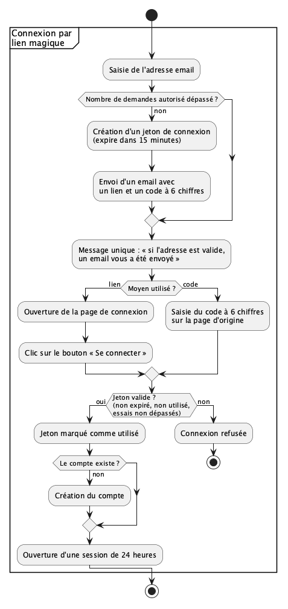

### Modification d'un utilisateur

Tout utilisateur authentifié peut modifier sa fiche. Un utilisateur désabonné peut aussi s'y réabonner aux emails d'alerte (le champ `desabonne_at` est vidé; voir [Désabonnement des emails d'alerte](#désabonnement-des-emails-dalerte)).

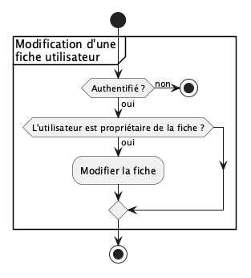

### Déconnexion d'un utilisateur

Tout utilisateur peut se déconnecter de l'application. La session est effacée et le cookie de session supprimé. Une session expire de toute façon 24 heures après la connexion.

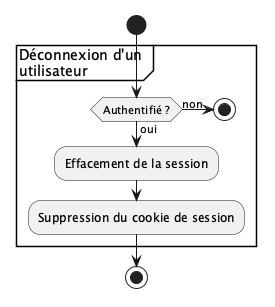

### Suppression d'un utilisateur

Tout utilisateur peut supprimer son compte, après confirmation. Son compte, ses alertes, ses emails d'alerte et leurs envois, ses sessions et ses jetons de connexion sont effacés immédiatement et définitivement (voir [Suppression de données](#suppression-de-données)). L'utilisateur est déconnecté.

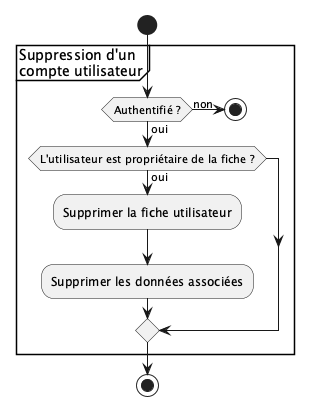

### Export des données d'un utilisateur

Tout utilisateur authentifié peut exporter ses données (droit à la portabilité): son compte, ses alertes et les emails d'alerte qui lui ont été envoyés, dans un fichier au format JSON.

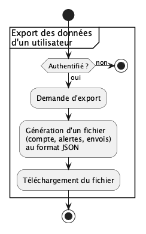

## Workflows des alertes

### Création d'une alerte

Tout utilisateur a le droit de créer des alertes.

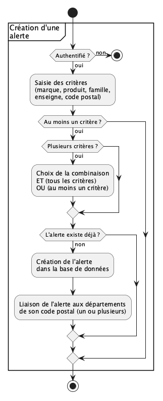

### Modification d'une alerte

Tout utilisateur a le droit de modifier ses propres alertes.

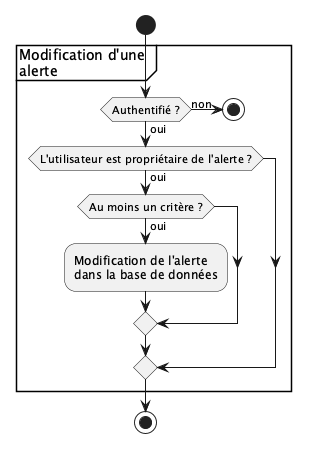

### Suppression d'une alerte

Tout utilisateur a le droit de supprimer ses propres alertes.

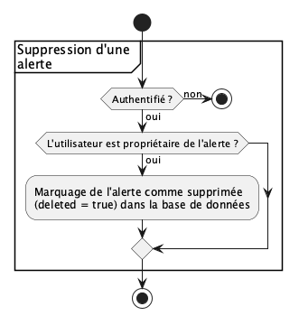

### Envoi des alertes

À la fin de chaque collecte, le backend compare chaque [rappel à traiter](#rappels-à-traiter) (fiche RappelConso dont le numéro était inconnu) à chaque alerte. Il envoie ensuite **un seul email** à chaque utilisateur dont au moins une alerte correspond.

Une alerte ne reçoit que les rappels collectés après sa configuration: un rappel n'est comparé à une alerte que si sa date de collecte (`date_collecte`) est postérieure à la date de configuration de l'alerte (`date_configuration`, mise à jour à chaque modification). Les rappels antérieurs restent consultables, et l'aperçu de la page de création d'alerte les montre.

Un critère d'une alerte correspond à un rappel lorsque:

- **enseigne** : l'enseigne est liée au rappel, ou le rappel concerne toutes les enseignes (`toutes_enseignes`); un rappel sans enseigne ne correspond à aucun critère *enseigne* (voir [Interprétation des distributeurs](#interprétation-des-distributeurs));
- **marque** : la marque retenue du rappel est la marque retenue de l'alerte (voir [Fusion de marques](#fusion-de-marques));
- **produit** : le produit (code-barres) est lié au rappel;
- **famille de produit** : la famille est celle du rappel (jamais celle de ses produits, qui gardent la famille de la première fiche qui les a cités);
- **code postal** : l'un des départements du code postal de l'alerte (table [alertes départements](#alertes-départements)) fait partie de la géographie retenue (voir [Géographie par enseigne](#géographie-par-enseigne)); une géographie « France entière » comprend tous les départements. La géographie retenue est:
  - si l'alerte a la combinaison `ET` et un critère *enseigne*: la géographie de cette enseigne pour ce rappel (ex: « Leclerc ET 67 » ne correspond pas à un rappel « France entière » qui ne cite E.Leclerc que par son magasin de Fécamp);
  - sinon: la géographie du rappel.

Selon la `combinaison` de l'alerte, tous les critères renseignés doivent correspondre (`ET`) ou au moins un (`OU`). Un même rappel n'est jamais signalé deux fois pour une même alerte: chaque correspondance est enregistrée dans la table [envois](#envois).

**Regroupement.** Les correspondances sont regroupées par utilisateur: l'email d'une collecte liste les nouveaux rappels qui le concernent, chacun **une seule fois**, même si plusieurs de ses alertes y correspondent. Pour chaque rappel, l'email affiche d'abord la conduite à tenir et les risques, puis les alertes qui l'ont déclenché (ex: « vos alertes *Marque X* et *Carrefour, 67* ») et un lien vers le détail du rappel. Les utilisateurs désabonnés (champ `desabonne_at` renseigné) ne reçoivent rien. Les correspondances incertaines ne sont retenues que pour les utilisateurs dont la politique de risque est prudente (voir [Correspondances incertaines](#correspondances-incertaines)).

**Nouvelles tentatives.** L'email et ses envois sont d'abord enregistrés en base (statut `à envoyer`), puis l'email est envoyé: un arrêt du backend pendant l'envoi ne fait donc perdre aucun email.

- en cas d'**échec temporaire** (prestataire d'envoi indisponible, délai dépassé, refus temporaire du serveur destinataire), l'envoi est retenté avec un délai croissant (ex: 5 minutes, 30 minutes, 2 heures, 6 heures), en au plus 5 tentatives (ex); au-delà, l'email passe au statut `abandonné`;
- en cas d'**échec définitif** (ex: adresse inexistante), l'email n'est pas retenté et passe directement au statut `abandonné`;
- chaque email porte un identifiant unique transmis au prestataire d'envoi, pour qu'une nouvelle tentative ne produise pas de doublon.

*NB (à traiter plus tard): volume d'envoi. Une alerte qui ne porte que sur un code postal reçoit environ 70 % des rappels (rappels « France entière »). Avec 100 000 inscrits, une collecte peut produire plusieurs dizaines de milliers d'emails par jour. Le dimensionnement et le coût du prestataire d'envoi, ses limites de débit et la réputation du domaine d'envoi restent à étudier.*

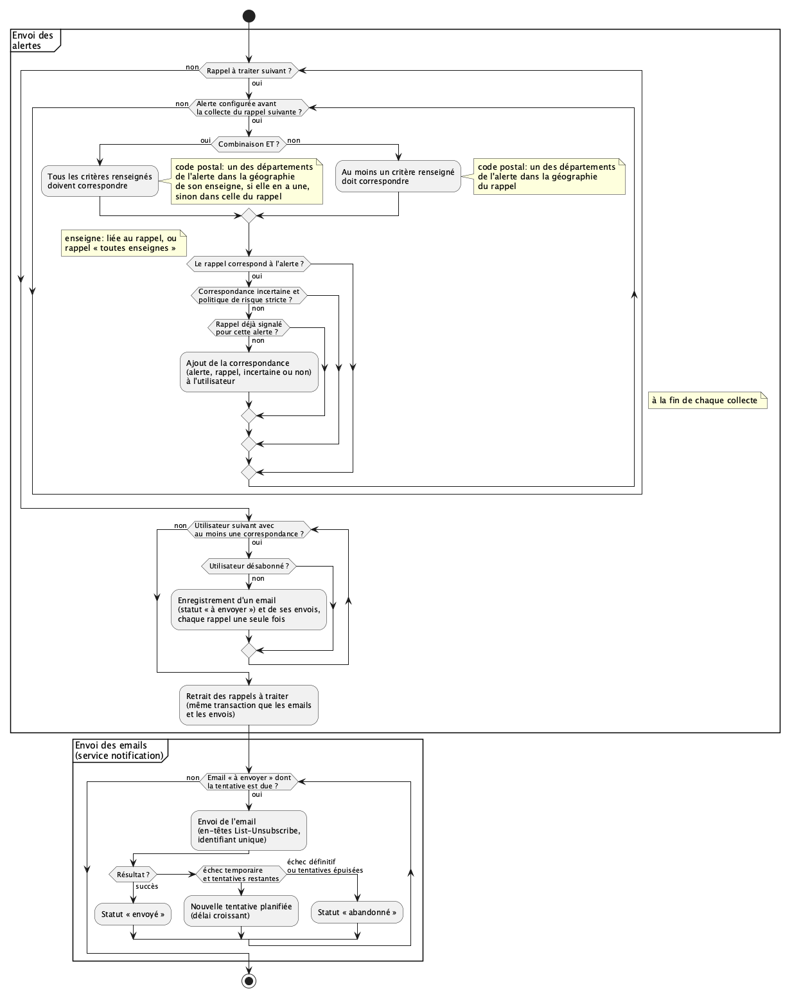

### Correspondances incertaines

Un critère correspond **de façon incertaine** lorsqu'il ne correspond que grâce à une interprétation par défaut. Seul le critère *code postal* est concerné: il correspond de façon incertaine lorsqu'il ne correspond que par la zone de vente du rappel, laissée en « France entière » parce qu'elle est incertaine (`zone_incertaine`), et non par un magasin lié.

Une correspondance entre une alerte et un rappel est incertaine si, avec la combinaison `ET`, au moins un critère correspond de façon incertaine; avec la combinaison `OU`, si tous les critères qui correspondent le font de façon incertaine.

Chaque utilisateur choisit sa **politique de risque** (champ `politique_risque`, page *Mon compte*):

- **prudente** (par défaut): il reçoit aussi les correspondances incertaines. Dans l'email, ces rappels sont signalés comme tels (ex: « zone de vente non précisée: ce rappel vous est signalé par prudence »);
- **stricte**: il ne reçoit que les correspondances certaines. Les correspondances incertaines ne sont ni envoyées ni enregistrées.

### Désabonnement des emails d'alerte

Chaque email d'alerte permet de se désabonner en un clic, selon la [RFC 8058](https://www.rfc-editor.org/rfc/rfc8058), exigée par les principales messageries pour les envois en nombre:

- l'email porte les en-têtes `List-Unsubscribe: <https://<domaine>/api/desabonnement/<jeton>>` et `List-Unsubscribe-Post: List-Unsubscribe=One-Click`. La messagerie de l'utilisateur envoie alors une requête `POST` à cette adresse, sans cookie ni confirmation, et l'utilisateur est désabonné. Une requête `GET` à cette adresse ne désabonne pas: elle redirige vers la [page de désabonnement](#pages-publiques);
- l'email contient aussi un lien visible « Ne plus recevoir ces alertes », qui ouvre la page de désabonnement. Comme pour le lien magique, l'ouverture de la page ne désabonne pas: c'est son bouton qui désabonne, pour que les filtres de sécurité des messageries, qui ouvrent les liens, ne désabonnent pas l'utilisateur à sa place;
- le jeton est tiré au hasard et propre à chaque email; seule son empreinte est stockée; il ne permet que le désabonnement (ni connexion, ni accès aux données) et n'est jamais écrit dans les traces;
- se désabonner arrête **tous** les emails d'alerte de l'utilisateur (champ `desabonne_at`); son compte et ses alertes sont conservés. Il peut se réabonner depuis la page *Mon compte*;
- les emails de connexion (lien magique) ne sont pas concernés: ils ne sont envoyés qu'à la demande de l'utilisateur.

## Workflows des rappels

### Collecte des rappels

Le backend (composant ``service lecture``) lit régulièrement l'open data RappelConso, seule source de rappels de cette première version. La collecte a lieu une fois par jour. Elle ne lit que les fiches publiées depuis la dernière collecte réussie, page par page (voir [Sources des rappels](#sources-des-rappels)); son état est enregistré dans la table [collectes](#collectes).

Pour chaque fiche RappelConso lue:

- si c'est une fiche RAPEX, elle est ignorée;
- si son numéro de fiche (`numero_fiche`) est déjà connu, elle est ignorée, même si elle a été republiée (nouvel `id`, nouvelle `date_publication`): un rappel n'est jamais modifié et une republication ne déclenche aucune alerte (voir [Gouvernance des rappels](#gouvernance-des-rappels));
- sinon, le rappel est créé, ainsi que les données de référence qu'il mentionne et ses liens avec les produits, enseignes, magasins et départements, obtenus en interprétant ses textes libres (voir [Interprétation des textes libres](#interprétation-des-textes-libres)); sa marque est reconnue par la [fusion de marques](#fusion-de-marques). Les éléments non reconnus sont signalés. Le rappel est ajouté aux [rappels à traiter](#rappels-à-traiter), dans la même transaction.

À la fin de la collecte, les alertes sont envoyées pour tous les rappels à traiter, y compris ceux qu'une collecte précédente interrompue a laissés. La collecte est alors marquée comme réussie.

**Reprise sur erreur.** Si la collecte échoue (API indisponible, arrêt du backend…), elle est marquée comme échouée, ou reste « en cours » si le backend s'est arrêté. La collecte suivante repart du début de la dernière collecte réussie: les fiches déjà créées sont ignorées grâce à leur numéro, et les rappels restés à traiter sont envoyés.

**Traces.** Chaque collecte écrit dans les traces son début, sa fin, son statut, le nombre de fiches lues et de rappels créés, et les éléments non reconnus. L'exploitant configure une alerte sur ces traces (ex: aucune collecte réussie depuis 48 heures, ou une collecte qui ne lit aucune fiche plusieurs jours de suite), pour qu'une panne de la collecte ou un changement de format de RappelConso ne passe pas inaperçu.

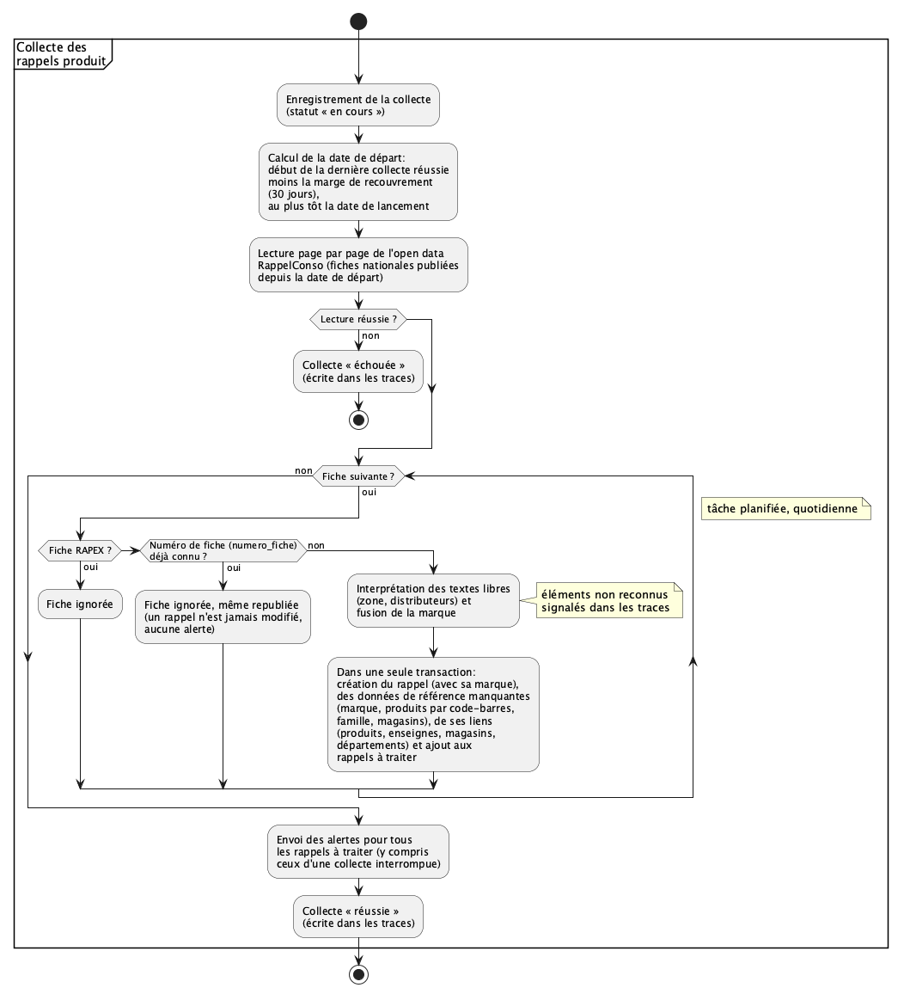

### Consultation des rappels

Tout utilisateur authentifié peut consulter les rappels, avec ou sans filtres, et le détail de chaque rappel.

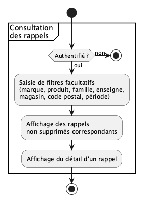

## Workflows des données de référence

Les données de référence sont les marques, les produits, les familles de produits, les enseignes et les magasins. Elles suivent toutes les mêmes workflows.

### Création et modification d'une donnée de référence

Les marques, produits, familles de produits et magasins sont créés et modifiés uniquement par le backend, lors de la collecte, à partir des informations contenues dans les rappels. Les fusions de marques sous le seuil sont décidées par le Product Owner dans un fichier versionné avec le code (voir [Fusion de marques](#fusion-de-marques)). Les enseignes, leurs écritures et le référentiel géographique viennent de fichiers déclarés ou de sources officielles (voir [Interprétation des textes libres](#interprétation-des-textes-libres)). Aucun utilisateur ne peut les créer ni les modifier depuis l'application.

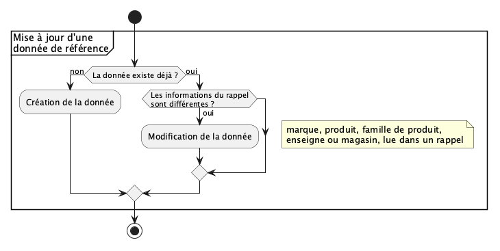

### Suppression d'une donnée par l'administrateur

Seul l'administrateur peut supprimer un rappel ou une donnée de référence (marque, produit, famille de produit, magasin; les enseignes relèvent du fichier déclaré). La donnée est effacée immédiatement et définitivement, avec ses liens (voir [Suppression de données](#suppression-de-données)).

Un rappel supprimé dont RappelConso republie ensuite la fiche, ou dont la fiche a moins de 30 jours (marge de recouvrement), est recréé à la collecte suivante, et les emails d'alerte repartent. C'est voulu: l'administrateur en porte la responsabilité. Chaque suppression est écrite dans les traces, sans identifier l'administrateur (voir [Suppression de données](#suppression-de-données)).

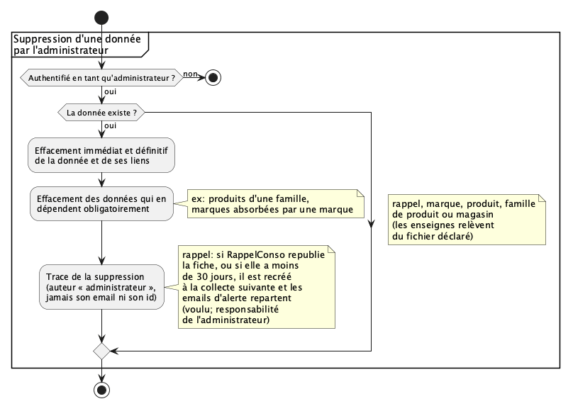

## Workflows des statistiques

### Consultation des statistiques

Tout utilisateur authentifié peut consulter les statistiques, selon un axe d'analyse et une période.

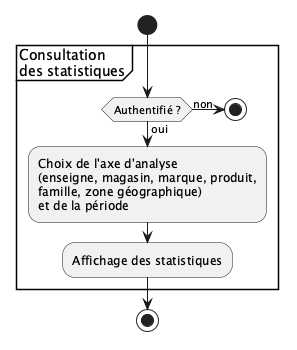

## Workflows d'administration

### Connexion d'un administrateur

L'administrateur se connecte comme tout utilisateur, par [lien magique](#connexion-par-lien-magique). Le backend compare ensuite l'adresse email de l'utilisateur connecté à l'adresse de l'administrateur, stockée dans un secret local au backend et absente de la base de données. Si elles sont identiques, l'utilisateur a accès aux fonctionnalités d'administration.

Cette première version gère un seul administrateur, sans second facteur: la sécurité du compte administrateur repose sur celle de sa boîte mail.

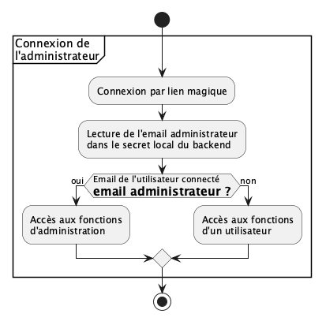

### Purge des données expirées

Une tâche planifiée efface chaque jour les traces d'accès de plus d'un an, ainsi que les jetons de connexion et les sessions expirés ou utilisés (voir [Durée de conservation des données](#durée-de-conservation-des-données)).

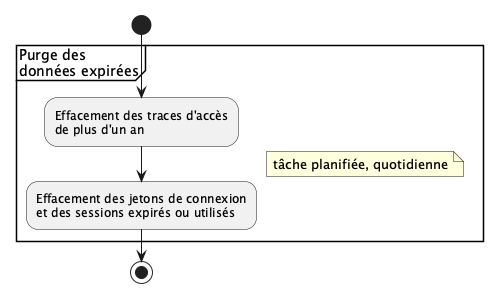

# Backend
Le backend gère la partie métier. Il stocke les données dans une base de données. Il propose une API de communication pour le frontend. Il récupère les évènements liés aux rappels de produits pour mettre à jour sa base de données et recalculer les statistiques.

## Architecture

Le backend de l'application implémente la logique métier de l'application. Le backend est composé:

1. d'une interface *REST* (HTTP et JSON) proposant une API pour le frontend, décrite par un contrat OpenAPI (voir [Interfaces](#interfaces))
2. de quatre composants
   1. le composant ``logique métier`` implémente la valeur ajoutée de l'application : gestion des données; gouvernance etc.
   2. le composant ``service lecture``, en charge de récupérer les rappels de produits
   3. le composant ``service base de données``, en charge de l'interaction avec le système de gestion de base de données. Ce service est le seul autorisé à lire et écrire la DB: il tourne dans son propre conteneur, précédé d'un conteneur d'initialisation à exécution unique (même binaire) qui crée le schéma puis s'arrête; ces deux conteneurs sont les seuls à atteindre PostgreSQL et les seuls à détenir les mots de passe de ses rôles, chacun ne recevant que celui du rôle qu'il utilise (PostgreSQL n'en reçoit que les condensés). Les autres composants l'appellent par une interface interne (voir [Interfaces](#interfaces)), qui n'expose que des opérations métier, jamais de requête SQL libre. Cette interface est authentifiée dès la première version: chaque service appelant a son propre jeton et la liste des opérations qu'il a le droit d'appeler; toute autre opération lui est refusée. Le service base de données se connecte à PostgreSQL avec des rôles ordinaires, jamais en superutilisateur. Une opération qui doit être atomique (ex: créer un rappel et l'ajouter aux rappels à traiter) est un seul appel, exécuté dans une seule transaction.
   4. le composant ``service notification``, en charge de l'envoi des alertes par email aux utilisateurs concernés par un nouveau rappel produit.

**Instances.** Le service lecture (collecte) et le service notification (envoi des emails) tournent chacun en **une seule instance**: RappelConso est la seule source de vérité, et une collecte par jour ne demande aucune montée en charge. Deux collectes ou deux envois simultanés produiraient des emails en double. Le déploiement doit donc garantir qu'il n'en existe jamais deux à la fois: dans le fichier docker compose, ces deux services n'ont qu'un seul conteneur (jamais de `--scale` ni de `replicas` supérieur à 1). Lors d'une mise à jour, docker compose arrête l'ancien conteneur avant de démarrer le nouveau. Seule l'API, qui sert le frontend, peut tourner en plusieurs conteneurs pour absorber les pics de consultation. Le service base de données tourne aussi en une seule instance dans cette version: son conteneur d'initialisation crée le schéma de la base avant son démarrage (voir *Schéma de la base*).

**Déploiement.** L'application est déployée avec **docker compose**, sur un serveur OVH en France: un conteneur par service (frontend, API, service lecture, service notification, service base de données et son conteneur d'initialisation, PostgreSQL), dans des réseaux séparés: seuls le service base de données et son conteneur d'initialisation atteignent PostgreSQL. Les secrets (adresse de l'administrateur, mots de passe de la base, clé du prestataire d'envoi) sont fournis par des fichiers de secrets docker compose, jamais en clair dans le fichier compose ni dans les images; chacun n'est donné qu'au conteneur qui en a besoin (le mot de passe du rôle propriétaire du schéma au seul conteneur d'initialisation du service base de données, celui du rôle applicatif au seul service base de données, PostgreSQL ne recevant, pour créer ces deux rôles, que leurs condensés SCRAM-SHA-256, jamais les mots de passe en clair; le mot de passe du superutilisateur de la base à PostgreSQL seul).

**Schéma de la base.** Il n'y a pas d'outil de migration dans cette version. Le conteneur d'initialisation du service base de données crée le schéma, avant le démarrage du service, lorsque la base est vide, à partir d'un fichier SQL embarqué dans son binaire; le service vérifie ensuite la version du schéma sans le modifier. Avant la date de lancement, la base ne contient aucune donnée réelle: un changement de schéma se traite en recréant la base de développement ou de test. Le moyen de faire évoluer le schéma d'une base qui contient des données réelles sera décidé avec le premier changement de schéma après le lancement.

**Un seul serveur.** Docker compose fait tourner tous les conteneurs sur une seule machine. Dans cette première version:

- monter en charge consiste à ajouter des conteneurs d'API sur ce serveur, ou à prendre un serveur plus puissant; répartir l'application sur plusieurs serveurs demandera un autre outil de déploiement;
- une panne du serveur arrête tout le service (site et alertes). C'est une limite assumée: les rappels restent publiés par RappelConso, et la [reprise sur erreur](#collecte-des-rappels) de la collecte envoie au redémarrage les alertes des rappels publiés pendant la panne (dans la limite de la marge de recouvrement de 30 jours).

**Sauvegardes.** La base de données est sauvegardée chaque jour (ex: `pg_dump`):

- la sauvegarde est chiffrée et stockée hors du serveur, chez OVH en France (ex: stockage objet), pour survivre à la perte du serveur;
- chaque sauvegarde est conservée 30 jours, puis effacée;
- la restauration est testée régulièrement (ex: chaque mois, sur un environnement de test): une sauvegarde jamais restaurée n'est pas une sauvegarde;
- les sauvegardes contiennent des données personnelles: un compte supprimé y reste jusqu'à l'expiration de la dernière sauvegarde qui le contient (voir [Durée de conservation des données](#durée-de-conservation-des-données)). Après une restauration, les comptes supprimés depuis la sauvegarde sont effacés à nouveau: chaque suppression de compte est écrite dans les traces avec l'identifiant de l'utilisateur (`id_user`), jamais son adresse email.

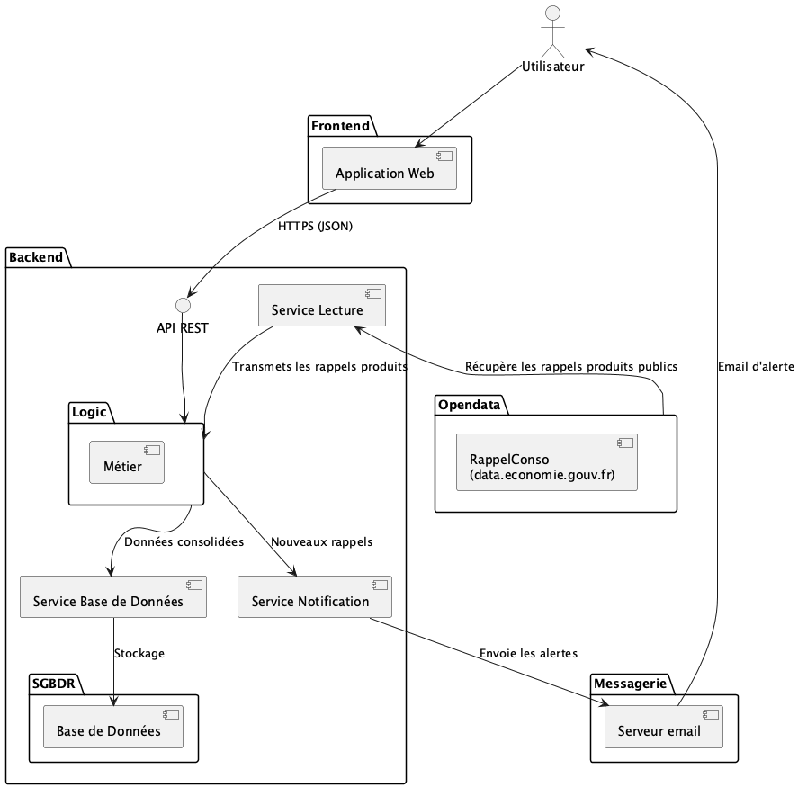


## Interfaces

L'API du backend est une API REST (HTTP et JSON), servie sous `https://<domaine>/api/`. Elle est décrite par un contrat OpenAPI 3.0, `doc/api/openapi.yaml`, qui fait foi pour le backend comme pour le frontend: le code serveur Go et le client TypeScript en sont générés (ex: oapi-codegen, openapi-typescript).

L'interface interne du service base de données (voir [Architecture](#architecture-1)) n'est appelée que par les autres composants du backend, sur un réseau interne, jamais depuis l'extérieur. Son protocole et son contrat sont fixés par l'ADR du socle.

Les données communes (rappels, données de référence, statistiques) ne sont accessibles qu'aux utilisateurs connectés (voir [Gouvernance](#gouvernance)). Elles ne sont donc jamais placées dans un cache partagé (CDN, proxy), qui les servirait sans vérifier la session. Elles peuvent être mises en cache par le backend, après vérification de la session, et par le navigateur (`Cache-Control: private`, `ETag`). Les données personnelles ne sont jamais mises en cache (`Cache-Control: no-store`).

*à faire*: le contrat lui-même.

# Frontend

Le frontend est l'interface web de CADI: c'est par lui que l'utilisateur se connecte, gère ses alertes, consulte les rappels et les statistiques, et exerce ses droits RGPD. Il ne contient aucune logique métier: toutes les règles (gouvernance, correspondance des alertes, autorisations) sont appliquées par le backend.

Les alertes elles-mêmes sont reçues par email: un utilisateur peut donc rester informé sans revenir sur le site.

## Architecture

Le frontend est une application web monopage (*Single Page Application*), développée en **React** avec **TypeScript**. Node.js sert à la construire (outils de développement et de compilation, ex: *Vite*); en production, le frontend n'est qu'un ensemble de fichiers statiques.

- **hébergement** : les fichiers statiques sont servis par un serveur web chez OVH, en France, comme le backend;
- **même domaine que l'API** : le frontend (ex: `https://<domaine>/`) et l'API REST du backend (ex: `https://<domaine>/api/`) partagent le même domaine. Le cookie de session (`HttpOnly`, `Secure`, `SameSite=Lax`) est donc envoyé automatiquement, sans configuration CORS;
- **communication avec le backend** : uniquement par l'API REST, en HTTPS. Le client TypeScript est généré à partir du contrat OpenAPI (voir [Interfaces](#interfaces));
- **état de connexion** : le frontend n'a jamais accès à l'identifiant de session, porté par un cookie `HttpOnly`. Pour savoir si l'utilisateur est connecté, et s'il est l'administrateur, il interroge l'API (ex: `GET /api/moi`). Le menu d'administration n'est affiché que si l'API répond que l'utilisateur est l'administrateur; le backend vérifie de toute façon les droits à chaque requête;
- **aucun service tiers** : pas d'outil de suivi ou de publicité, pas de police, script ou feuille de style chargés depuis un autre domaine. Le seul cookie est le cookie de session, strictement nécessaire: aucune bannière de consentement n'est donc requise (voir [Consentement et Cookies](#consentement-et-cookies)). *NB: si une mesure d'audience est souhaitée, elle devra être auto-hébergée et configurée pour être exemptée de consentement (ex: Matomo, selon les recommandations de la CNIL).*;
- **langue** : français uniquement dans cette première version;
- **mobile d'abord** : l'interface est conçue d'abord pour un écran de téléphone, puis adaptée aux écrans plus larges. Une application installable (*PWA*) ou une application mobile native pourront venir dans une phase ultérieure.

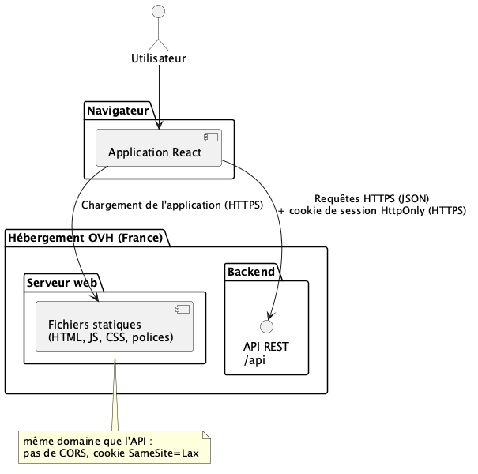

## Workflow

Le plan de navigation ci-dessous montre les pages du frontend et les passages de l'une à l'autre. Chaque page met en œuvre un ou plusieurs workflows décrits au chapitre [Workflow](#workflow).

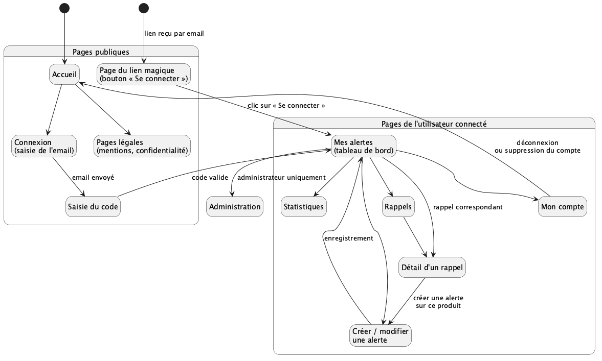

| Page | Workflows |
|---|---|
| Désabonnement | [Désabonnement des emails d'alerte](#désabonnement-des-emails-dalerte) |
| Connexion, saisie du code, page du lien magique | [Connexion par lien magique](#connexion-par-lien-magique), [Connexion d'un administrateur](#connexion-dun-administrateur) |
| Mes alertes, créer / modifier une alerte | [Création](#création-dune-alerte), [modification](#modification-dune-alerte) et [suppression](#suppression-dune-alerte) d'une alerte |
| Rappels, détail d'un rappel | [Consultation des rappels](#consultation-des-rappels) |
| Statistiques | [Consultation des statistiques](#consultation-des-statistiques) |
| Mon compte | [Modification](#modification-dun-utilisateur), [déconnexion](#déconnexion-dun-utilisateur), [suppression](#suppression-dun-utilisateur) et [export des données](#export-des-données-dun-utilisateur) d'un utilisateur |
| Administration | [Suppression d'une donnée par l'administrateur](#suppression-dune-donnée-par-ladministrateur) |

## Interface utilisateur

### Principes

- **simplicité** : l'utilisateur type est un consommateur, pas un expert; chaque page a un seul objectif principal;
- **sécurité du consommateur d'abord** : sur un rappel, la conduite à tenir (ne plus consommer, rapporter le produit…) et les risques sont affichés en premier, avant les détails techniques;
- **langage clair** : pas de jargon (on écrit « code-barres » et non « GTIN »);
- **accessibilité** : l'interface respecte le référentiel général d'amélioration de l'accessibilité (RGAA), qui correspond au niveau AA des WCAG;
- **sobriété** : pages légères, utilisables avec une connexion mobile lente.

### Pages publiques

1. **Accueil** : présente CADI en quelques phrases et propose de se connecter.
2. **Connexion** : un seul champ, l'adresse email. Après validation, la page affiche toujours le même message (« si l'adresse est valide, un email vous a été envoyé ») et un champ pour saisir le code à 6 chiffres.
3. **Page du lien magique** : ouverte par le lien reçu par email, elle affiche uniquement un bouton « Se connecter ». Si le lien a expiré ou a déjà été utilisé, elle l'indique et propose de recevoir un nouveau lien.
4. **Pages légales** : mentions légales et politique de confidentialité.
5. **Page de désabonnement** : ouverte par le lien en bas d'un email d'alerte, sans connexion. Elle affiche un bouton « Ne plus recevoir d'alertes par email », puis confirme le désabonnement et indique qu'on peut se réabonner depuis *Mon compte*.

### Pages de l'utilisateur connecté

6. **Mes alertes** (tableau de bord, page d'arrivée après la connexion) : liste des alertes de l'utilisateur, résumées en une phrase chacune, et derniers rappels qui leur correspondent. Si l'utilisateur n'a encore aucune alerte, la page l'invite à en créer une.
7. **Créer / modifier une alerte** : un formulaire avec les critères (marque, produit, famille de produit, enseigne, code postal):
   - chaque critère propose une saisie avec suggestions automatiques, parmi les données connues de l'application;
   - les familles de produits sont présentées en deux niveaux (catégorie, puis sous-catégorie);
   - le choix de la combinaison n'apparaît que si au moins deux critères sont renseignés, sous forme de question simple: « Être prévenu si **tous** ces critères correspondent (ET) » ou « si **au moins un** correspond (OU) »;
   - un résumé en français indique ce que fait l'alerte (ex: « Vous serez prévenu de tout rappel d'un produit de la marque X vendu chez Carrefour »);
   - un aperçu montre les rappels des 12 derniers mois (au plus depuis la date de lancement du service) qui auraient déclenché l'alerte, selon la politique de risque de l'utilisateur, pour qu'il vérifie qu'elle correspond à ce qu'il attend; les rappels incertains y sont signalés;
   - l'enregistrement est impossible tant qu'aucun critère n'est renseigné.
8. **Rappels** : liste des rappels, du plus récent au plus ancien, avec une recherche par nom ou par code-barres et des filtres (marque, famille, enseigne, magasin, code postal, période).
9. **Détail d'un rappel** : conduite à tenir et risques en premier, puis produit, photo, lots concernés, motif, distributeurs, magasins, zone de vente, dates, et lien vers la fiche officielle. Un bouton « Créer une alerte » ouvre le formulaire pré-rempli avec la marque ou le produit du rappel.
10. **Statistiques** : graphiques du nombre de rappels selon un axe (enseigne, magasin, marque, produit, famille, zone géographique) et une période.
11. **Mon compte** : prénom et nom modifiables, adresse email, politique de risque (« recevoir aussi les rappels dont la zone de vente n'est pas précisée », cochée par défaut, avec une explication de ce que l'on risque de manquer en la décochant), réabonnement aux emails d'alerte après un désabonnement, export des données, déconnexion et suppression du compte. La suppression du compte demande une confirmation. Le changement d'adresse email est hors du périmètre de cette première version.

### Pages d'administration

Visibles uniquement par l'administrateur:

12. **Rappels et données de référence** : recherche et suppression d'un rappel, d'une marque, d'un produit, d'une famille de produit ou d'un magasin.

## Plan de test

- **tests unitaires** des composants (ex: Vitest et React Testing Library): affichage, formulaires, règles de saisie (au moins un critère, choix ET/OU, format du code à 6 chiffres);
- **tests de bout en bout** (ex: Playwright), sur un environnement de test avec une boîte mail de test pour recevoir les liens de connexion (ex: Mailpit). Parcours couverts:
  - connexion par lien et par code, lien expiré ou déjà utilisé, déconnexion, expiration de la session après 24 heures;
  - réception d'un seul email par collecte quand plusieurs alertes correspondent au même rappel; avec la politique prudente, un rappel incertain est reçu et signalé comme tel; avec la politique stricte, il n'est pas reçu; désabonnement en un clic (en-têtes `List-Unsubscribe`, requête `POST`) et par la page de désabonnement, puis réabonnement depuis *Mon compte*;
  - création, modification et suppression d'une alerte, avec et sans combinaison ET/OU;
  - recherche d'un rappel, consultation de son détail, création d'une alerte depuis ce détail;
  - export des données, suppression du compte;
  - accès à l'administration: autorisé pour l'administrateur, refusé à tout autre utilisateur, même en saisissant directement l'adresse de la page;
- **tests d'accessibilité** : vérification automatique à chaque modification (ex: axe), et audit RGAA manuel avant chaque mise en production majeure;
- **tests de compatibilité** : deux dernières versions de Chrome, Firefox, Safari et Edge; téléphones iOS et Android; largeurs d'écran du téléphone à l'ordinateur;
- **tests de performance** : un budget de poids des pages et de temps d'affichage, vérifié automatiquement (ex: Lighthouse);
- **tests de sécurité** : absence de toute donnée de session accessible au code JavaScript, en-têtes de sécurité (CSP, HSTS), affichage sans risque des textes issus des sources de rappels (voir ci-dessous).

## Gestion des risques

| Risque | Conséquence | Mesure |
|---|---|---|
| Un texte issu d'une fiche de rappel (texte libre saisi par le professionnel) contient du code malveillant | Exécution de code dans le navigateur de l'utilisateur (XSS) | Les textes des rappels sont toujours affichés comme du texte, jamais interprétés comme du HTML; politique de sécurité du contenu (CSP) stricte. |
| L'utilisateur comprend mal la combinaison ET/OU | Il se croit prévenu alors que son alerte ne correspondra jamais, ou reçoit trop d'emails | Résumé de l'alerte en français et aperçu des rappels passés qui l'auraient déclenchée. |
| L'utilisateur veut suivre une marque ou un produit qui n'a encore jamais été rappelé | Impossible de créer l'alerte: les marques et produits ne sont créés qu'à partir des rappels | Limite assumée: une alerte ne peut porter que sur des marques et des produits déjà apparus dans un rappel. Le formulaire de création ne propose que ces données. |
| Un utilisateur en politique de risque stricte ne reçoit pas un rappel incertain qui le concernait | Il n'est pas prévenu d'un rappel qui le concerne | Politique prudente par défaut; le choix de la politique stricte est explicite et explique ce que l'utilisateur risque de manquer. |
| Les fiches RAPEX ne sont pas collectées | Environ 1 000 fiches par an ne sont pas couvertes (voitures surtout, mais aussi des jouets et de la puériculture): leurs rappels ne sont pas signalés | Limite assumée pour la première version: seules les fiches nationales de RappelConso créent des rappels (voir [Sources des rappels](#sources-des-rappels)). |
| La fiche ne cite pas l'enseigne qui vend le produit (« gms », « voir pièce jointe », liste incomplète) | Une alerte qui ne porte que sur une enseigne ne reçoit pas le rappel, alors que le produit y est vendu | Limite assumée: un rappel sans enseigne n'a pas d'enseigne. Les formules « toutes enseignes » ne sont pas concernées: un tel rappel correspond à toute alerte sur une enseigne. Le formulaire d'alerte et l'aperçu invitent à ajouter un autre critère (marque, produit, famille, code postal) avec la combinaison OU. Les éléments non reconnus sont signalés pour compléter le fichier déclaré des enseignes. |
| La collecte échoue ou RappelConso change de format | Aucun rappel n'est collecté ni signalé, sans que personne ne le voie | Reprise sur erreur (table [collectes](#collectes), [rappels à traiter](#rappels-à-traiter)); traces de chaque collecte et alerte de l'exploitant sur ces traces (voir [Collecte des rappels](#collecte-des-rappels)). |
| La collecte n'a lieu qu'une fois par jour | Un rappel peut n'être signalé à l'utilisateur que jusqu'à 24 heures après sa publication par la source | Choix assumé pour la première version: CADI complète les canaux officiels (RappelConso, affichage en magasin) sans les remplacer. La fréquence de collecte est un paramètre de configuration: elle pourra être augmentée (ex: RappelConso toutes les heures) sans changer l'architecture. |
| L'email de connexion arrive en retard ou dans les indésirables | L'utilisateur ne peut pas se connecter | Prestataire d'envoi fiable; la page de connexion explique de vérifier les indésirables et permet de demander un nouvel email. |
| Le backend est indisponible | Le site ne fonctionne plus | Message d'erreur clair; les alertes déjà configurées continuent d'être envoyées par email dès le retour du backend. |
| Le serveur tombe en panne (tout tourne sur un seul serveur, avec docker compose) | Le site et les alertes s'arrêtent jusqu'à la remise en service | Limite assumée pour la première version. Au redémarrage, la reprise sur erreur de la collecte envoie les alertes des rappels publiés pendant la panne (voir [Architecture du backend](#architecture-1)). |
| Le serveur ou sa base de données est perdu | Perte des comptes et des alertes | Sauvegarde quotidienne chiffrée, stockée hors du serveur chez OVH en France, conservée 30 jours; restauration testée régulièrement. |
| Forte affluence (pic de consultation après un rappel médiatisé) | Lenteur du site | Le frontend est fait de fichiers statiques, faciles à servir en grand nombre (cache, réseau de diffusion hébergé en France ou dans l'UE). |
| Une bibliothèque JavaScript utilisée par le frontend est compromise ou vulnérable | Faille de sécurité | Peu de dépendances, versions figées (*lockfile*), audit automatique des vulnérabilités et mises à jour régulières. |
| Un service tiers (police, statistiques, CDN) collecte des données sur les visiteurs | Non-conformité RGPD | Aucun service tiers: toutes les ressources sont servies depuis le domaine de CADI. |

# Outils externes

- Open data  : https://www.data.gouv.fr/dataservices/explore-api-v2-48 ; fiches RappelConso, jeu de données `rappelconso-v2-gtin-espaces` (voir [Sources des rappels](#sources-des-rappels))
- Modèle d'IA de la [fusion de marques](#fusion-de-marques) : reste à choisir (voir le NB de cette section)
- Base officielle des codes postaux (La Poste, open data) : correspondance entre codes postaux, communes et départements, https://www.data.gouv.fr/fr/datasets/base-officielle-des-codes-postaux/
- Code officiel géographique (INSEE) : liste officielle des départements et des régions, et correspondance entre départements et régions, https://www.insee.fr/fr/information/2560452

# Glossaire

# Misc

Pour convertir ce fichier en pdf, on peut faire
```
pandoc specifications.md --pdf-engine prince -o specifications.pdf
```

