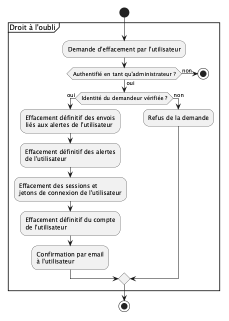

# CADI

CADI (Consommation Alerte Danger Informations)
- [CADI](#cadi)
- [Introduction](#introduction)
  - [Objectif de l’application](#objectif-de-lapplication)
  - [Périmètre fonctionnel](#périmètre-fonctionnel)
  - [Périmètre technique](#périmètre-technique)
- [Architecture](#architecture)
- [Conformité](#conformité)
  - [Collecte et Traitement des Données](#collecte-et-traitement-des-données)
  - [Droits des Utilisateurs](#droits-des-utilisateurs)
  - [Droits des enseignes et des marques](#droits-des-enseignes-et-des-marques)
  - [Sécurité et Protection des Données](#sécurité-et-protection-des-données)
  - [Consentement et Cookies](#consentement-et-cookies)
  - [Sous-traitants et Partage des Données](#sous-traitants-et-partage-des-données)
  - [Durée de Conservation des Données](#durée-de-conservation-des-données)
  - [Point de Contact et DPO](#point-de-contact-et-dpo)
- [Sécurité](#sécurité)
- [Fonctionnalités](#fonctionnalités)
  - [Gouvernance](#gouvernance)
    - [Gouvernance des utilisateurs](#gouvernance-des-utilisateurs)
    - [Gouvernance des alertes](#gouvernance-des-alertes)
    - [Gouvernance des marques](#gouvernance-des-marques)
    - [Gouvernance des produits](#gouvernance-des-produits)
    - [Gouvernance des familles de produit](#gouvernance-des-familles-de-produit)
    - [Gouvernance des enseignes](#gouvernance-des-enseignes)
    - [Gouvernance des magasins](#gouvernance-des-magasins)
    - [Gouvernance des rappels](#gouvernance-des-rappels)
    - [Gouvernance des statistiques](#gouvernance-des-statistiques)
- [Structures des données](#structures-des-données)
  - [Utilisateurs](#utilisateurs)
  - [Marques](#marques)
  - [Produits](#produits)
  - [Familles de produits](#familles-de-produits)
  - [Enseignes](#enseignes)
  - [Magasins](#magasins)
  - [Alertes](#alertes)
  - [Rappels](#rappels)
  - [Sources des rappels](#sources-des-rappels)
  - [Liens entre les rappels et les autres données](#liens-entre-les-rappels-et-les-autres-données)
  - [Envois](#envois)
  - [Jetons de connexion](#jetons-de-connexion)
  - [Sessions](#sessions)
  - [Statistiques](#statistiques)
- [Workflow](#workflow)
  - [Suppression de données](#suppression-de-données)
  - [Workflows des utilisateurs](#workflows-des-utilisateurs)
    - [Connexion par lien magique](#connexion-par-lien-magique)
    - [Modification d'un utilisateur](#modification-dun-utilisateur)
    - [Déconnexion d'un utilisateur](#déconnexion-dun-utilisateur)
    - [Suppression d'un utilisateur](#suppression-dun-utilisateur)
    - [Export des données d'un utilisateur](#export-des-données-dun-utilisateur)
  - [Workflows des alertes](#workflows-des-alertes)
    - [Création d'une alerte](#création-dune-alerte)
    - [Modification d'une alerte](#modification-dune-alerte)
    - [Suppression d'une alerte](#suppression-dune-alerte)
    - [Envoi des alertes](#envoi-des-alertes)
  - [Workflows des rappels](#workflows-des-rappels)
    - [Collecte des rappels](#collecte-des-rappels)
    - [Consultation des rappels](#consultation-des-rappels)
  - [Workflows des données de référence](#workflows-des-données-de-référence)
    - [Création et modification d'une donnée de référence](#création-et-modification-dune-donnée-de-référence)
    - [Suppression d'une donnée par l'administrateur](#suppression-dune-donnée-par-ladministrateur)
  - [Workflows des statistiques](#workflows-des-statistiques)
    - [Consultation des statistiques](#consultation-des-statistiques)
  - [Workflows d'administration](#workflows-dadministration)
    - [Connexion d'un administrateur](#connexion-dun-administrateur)
    - [Purge des données supprimées](#purge-des-données-supprimées)
    - [Droit à l'oubli](#droit-à-loubli)
- [Backend](#backend)
  - [Architecture](#architecture-1)
  - [Interfaces](#interfaces)
- [Frontend](#frontend)
  - [Architecture](#architecture-2)
  - [Workflow](#workflow-1)
  - [Interface utilisateur](#interface-utilisateur)
    - [Principes](#principes)
    - [Pages publiques](#pages-publiques)
    - [Pages de l'utilisateur connecté](#pages-de-lutilisateur-connecté)
    - [Pages d'administration](#pages-dadministration)
  - [Plan de test](#plan-de-test)
  - [Gestion des risques](#gestion-des-risques)
- [Outils externes](#outils-externes)
- [Glossaire](#glossaire)
- [Misc](#misc)

# Introduction

CADI est une application permettant de recevoir des alertes concernant les rappels produit en France afin que les consommateurs puissent facilement suivrent les rappels produits de différentes enseignes et du minitère de l'économie et des finances. 

Les utilisateurs de cette application sont des consommateurs.

## Objectif de l’application

Cette application a deux objectifs: (1) faciliter l'accès aux informations relatives aux rappels produit et (2) suivre les rappels produit pour pouvoir en faire des analyses et des suivis dans le temps, par produit, par type de produit, par marque de produit, par enseigne et par géographie.

Les utilisateurs sont invités à selectionner des produits, des familles de produits et des marques de produit à suivre. Ils peuvent aussi selectionner des zones géographiques et mêmes des magasins.

## Périmètre fonctionnel

L'application permet aux utilisateurs de s'enregistrer pour gérer des alertes relatives aux rappels produit en France. Les utilisateurs  peuvent spécifier des filtres pour recevoir les informations qui les intéressent: marque, enseigne, type de produit et zones géographiques. La zone gégraphique par défaut est "France métropolitaine et territoires d'outre mer". Sans aucun filtre, l'utilisateur ne reçoit rien: il faut au moins un critère de filtre. Lorsqu'une alerte comporte plusieurs critères, l'utilisateur choisit à la création de l'alerte s'ils doivent tous correspondre (ET) ou s'il suffit que l'un d'eux corresponde (OU).
Les alertes sont envoyées par email, à l'adresse associée au compte de l'utilisateur.
D'autre part, l'application calcule des statistiques mises à la disposition des utilisateurs.

## Périmètre technique

L'application sera accessible et utilisable sur une page Web. Elle sera développée en React et Node.js, pour le *frontend* et en Golang pour le *backend*. Le backend sera architecturé avec des composants faiblement couplés, pour une meilleure gestion des déploiements et de la scalabilité. L'application devra être scalable pour supporter jusqu’à 100 000 utilisateurs simultanés. Une application mobile native est prévue.


# Architecture

L'application est composée d'un frontend proposant une interface Web à l'utilisateur et d'un backend composé d'une base de donnée et d'un logiciel implémentant la partie métier.

Le stockage des informations se fait dans une base de données relationnelle; e.g postgresql.

 

# Conformité

## Collecte et Traitement des Données

L'application collecte les données personnelles suivantes 

- adresse mail
- pseudo
- alertes
- rappels
- enseignes
- marques
- produits

Ces données sont d'un intérêt légitimie pour l'application.

## Droits des Utilisateurs

Tout utilisateur a les droits suivants:

- droit d’accès pour consulter leurs données personnelles.;
- doit de rectification;
- droit à l’effacement ("droit à l’oubli") : tout utilisateur peut demander l'effacement définitif de ses données; la demande est traitée par un administrateur selon une procédure dédiée (voir [Durée de conservation des données](#durée-de-conservation-des-données));
- droit à la portabilité : tout utilisateur peut demander l'export de ses données.

## Droits des enseignes et des marques

Les informations collectées sur les marques et les enseignes sont fournies en open data par le gouvernement français. Il conviendra de vérifier les implications du stockage par l'application.

## Sécurité et Protection des Données

- **chiffrement** : les données en transit entre le frontend et le backend sont chiffrées (TLS 1.3; X25519MLKEM768).
- **authentification et accès** : l'accès est réservé aux utilisateurs authentifiés et eux seuls
- **stockage et hébergement** : cloud OVH avec serveurs en France
- **logs et traçabilité** : les traces des accès sont conservées pendant un an

## Consentement et Cookies

    Bannière de consentement : si des cookies de suivi sont utilisés, ils doivent être acceptés explicitement par l’utilisateur.
    Gestion du consentement : permettre aux utilisateurs de modifier leurs préférences à tout moment.
    Politique de confidentialité : mise à disposition d’un document expliquant clairement le traitement des données.

## Sous-traitants et Partage des Données

    Liste des prestataires : préciser les tiers avec lesquels les données sont partagées (ex. : le prestataire d'envoi des emails d'alerte).
    Contrats de sous-traitance : s’assurer que chaque prestataire respecte le RGPD (ex. : DPA - Data Processing Agreement).
    Transfert hors UE : indiquer si les données sont transférées hors de l’UE et préciser les garanties mises en place (ex. : clauses contractuelles types).

## Durée de Conservation des Données

1. Les données utilisateur sont conservées un an:

- une donnée supprimée par un utilisateur est marquée comme effacée (voir [Suppression de données](#suppression-de-données)), puis effacée définitivement de la base de données un an après sa suppression;
- les traces des accès sont conservées un an;
- les jetons de connexion et les sessions sont effacés dès qu'ils ont expiré ou ont été utilisés.

**Droit à l'oubli** : si un utilisateur demande l'effacement de ses données sans attendre ce délai, un administrateur applique une procédure dédiée qui efface définitivement de la base de données le compte de l'utilisateur et toutes ses alertes. La procédure est décrite dans le workflow [Droit à l'oubli](#droit-à-loubli).

2. Les rappels sont gardés indéfiniment.

## Point de Contact et DPO

    Nom et contact du Délégué à la Protection des Données (DPO) si applicable.
    Canaux pour exercer ses droits (ex. : formulaire en ligne, email dédié).

# Sécurité

La sécurité de l'application est assurée en implémentant les bonnes pratiques recommandées par [OWASP - *Open Web Application Security Project*](https://owasp.org/). 

Voici une liste non exhaustive des pratiques suivies:

- **authentification par lien magique** : l'utilisateur saisit son adresse email et reçoit un email contenant un lien de connexion et un code à 6 chiffres (voir [Connexion par lien magique](#connexion-par-lien-magique)):
  - l'application ne stocke aucun mot de passe et ne dépend d'aucun fournisseur d'identité tiers;
  - le lien et le code sont tirés au hasard, utilisables une seule fois, et expirent 15 minutes après l'envoi; seule leur empreinte (*hash*) est stockée en base de données;
  - le lien ne connecte pas l'utilisateur à son ouverture: il ouvre une page avec un bouton « Se connecter », et c'est ce bouton qui connecte. Les filtres de sécurité des messageries, qui ouvrent les liens des emails pour les analyser, ne peuvent donc pas consommer le lien à la place de l'utilisateur;
  - le code à 6 chiffres permet de se connecter sur un autre appareil que celui où l'email est lu; le nombre d'essais est limité (ex: 5) pour empêcher de deviner le code;
  - le nombre de demandes de connexion est limité par adresse email et par adresse IP (ex: 3 par heure et par adresse email), pour que l'application ne puisse pas servir à inonder la boîte mail d'un tiers;
  - la réponse à une demande de connexion est toujours la même (« si l'adresse est valide, un email vous a été envoyé »), pour ne pas révéler quelles adresses ont un compte;
  - la sécurité du compte repose sur celle de la boîte mail de l'utilisateur; l'envoi des emails doit être fiable et rapide (prestataire d'envoi, SPF, DKIM, DMARC);
- **sessions** : une session expire 24 heures après la connexion, pour des raisons de sécurité; elle est portée par un cookie `HttpOnly`, `Secure` et `SameSite=Lax`; la déconnexion invalide la session;
- **administrateur** : la base de données ne contient aucune information permettant d'identifier l'administrateur, pour ne rien révéler en cas de fuite de la base:
  - l'adresse email de l'administrateur est stockée dans un secret local au backend (ex: variable d'environnement ou fichier de secrets du serveur), jamais dans la base de données ni dans le dépôt de code, et jamais écrite dans les traces;
  - après chaque connexion, le backend compare l'adresse email de l'utilisateur connecté à ce secret (comparaison insensible à la casse, en temps constant); si elles sont identiques, l'utilisateur est l'administrateur;
  - changer d'administrateur revient à modifier le secret local et à redémarrer le backend;
  - voir [Connexion d'un administrateur](#connexion-dun-administrateur);
- **autorisation** : l'application implémente les autorisations; elle sont décrites au chapitre [fonctionnalité](#fonctionnalités)
- **stockage des informations**: les informations sont stockées dans une DB non chiffrée.

# Fonctionnalités

L’application permet de gérer des alertes de rappels produit et les statistiques associées. Seuls les utilisateurs enregistrés (ayant créé un compte) peuvent utiliser l'application. Les fonctionnalités sont les suivantes:

1. Gestion des utilisateurs : les utilisateurs doivent se connecter pour intéragir avec l'application; le compte est créé automatiquement à la première connexion; c'est la seule action possible sans être préalablement enregistré;
2. Gestion des alertes: les utilisateurs peuvent configurer les alertes sur les rappels produit qu'ils souhaitent recevoir; les alertes sont envoyées par email;
3. Gestion des marques: les utilisateurs peuvent configurer et recevoir les alertes par marque;
4. Gestion des produits: les utilisateurs peuvent configurer et recevoir les alertes par produit;
5. Gestion des familles de produits: les utilisateurs peuvent configurer et recevoir les alertes par famille de produit;
5. Gestion des enseignes et des magasins: les utilisateurs peuvent configurer et recevoir les alertes par enseigne ou par magasin;
6. Gestion des lieux géographiques: les utilisateurs peuvent peuvent configurer et recevoir les alertes par lieu géographique;
6. Statistiques: les utilisateurs peuvent lire les statistiques produites par l'application. Les statistiques sont calculées au fur et à mesure des rappels produits.


## Gouvernance

Les informations stockées par l’application sont gérées selon des règles de gouvernance décrites dans ce chapitre. Ces règles définissent la création, l'accès, la propriété et la suppression des données fournies à l'application.

### Gouvernance des utilisateurs

1. **Création** : tout utilisateur peut créer un compte;
2. **Propriété**: tout utilisateur possède son compte;
3. **Transfert de propriété**: il est impossible de transférer la propriété d'une fiche utilisateur;
4. **Lecture**: les fiches utilisateurs sont privées;
5. **Modification** : tout utilisateur peut modifier sa propre fiche;
6. **Suppression**: tout utilisateur peut supprimer sa fiche. Les alertes de l'utilisateur sont alors elles aussi supprimées.

### Gouvernance des alertes

1. **Création** : tout utilisateur peut créer des alertes;
2. **Propriété**: une alertes appartient au créateur de l'alerte;
4. **Lecture**: une alerte est accessible par son propriétaires;
5. **Modification** : une alerte peut être modifiée par son propriétaire;
6. **Transfert de propriété**: il est impossible de transférer la propriété d'une alerte;
6. **Suppression**: une alerte alerte peut être supprimée par son propriétaire.

### Gouvernance des marques

Les marques sont gérées par le backend, en fonction des rappels de produit détectés.

1. **Création** : le backend créé une marque qui apparait pour la première fois dans un rappel produit;
2. **Propriété**: les marques appartiennent au backend;
4. **Lecture**: les marques sont librement accessibles aux utilisateurs enregistrés;
5. **Modification** : le backend peut modifier une marque selon les informations contenues dans un rappel produit; cet évènement devrait être rare;
6. **Transfert de propriété**: il est impossible de transférer la propriété d'une marque;
6. **Suppression**: seul l'admlinitrateur peut supprimer une marque.

### Gouvernance des produits

Les produits sont gérés par le backend, en fonction des rappels de produit détectés.

1. **Création** : le backend créé un produit qui apparait pour la première fois dans un rappel produit;
2. **Propriété**: les produits appartiennent au backend;
4. **Lecture**: les produits sont librement accessibles aux utilisateurs enregistrés;
5. **Modification** : le backend peut modifier un produit selon les informations contenues dans un rappel produit; cet évènement devrait être rare;
6. **Transfert de propriété**: il est impossible de transférer la propriété d'un produit;
6. **Suppression**: seul l'admlinitrateur peut supprimer un produit.

### Gouvernance des familles de produit

Les familles de produits sont gérées par le backend, en fonction des rappels de produit détectés.

1. **Création** : le backend créé une famille de produit qui apparait pour la première fois dans un rappel produit;
2. **Propriété**: les familles de produits appartiennent au backend;
4. **Lecture**: les familles de produits sont librement accessibles aux utilisateurs enregistrés;
5. **Modification** : le backend peut modifier une famille de produits selon les informations contenues dans un rappel produit; cet évènement devrait être rare;
6. **Transfert de propriété**: il est impossible de transférer la propriété d'une famille de produits;
6. **Suppression**: seul l'admlinitrateur peut supprimer une famille de produits.

### Gouvernance des enseignes

Les enseignes sont gérées par le backend, en fonction des rappels de produit détectés.

1. **Création** : le backend créé une enseigne qui apparait pour la première fois dans un rappel produit;
2. **Propriété**: les enseignes appartiennent au backend;
4. **Lecture**: les enseignes sont librement accessibles aux utilisateurs enregistrés;
5. **Modification** : le backend peut modifier une enseigne selon les informations contenues dans un rappel produit; cet évènement devrait être rare;
6. **Transfert de propriété**: il est impossible de transférer la propriété d'une enseigne;
6. **Suppression**: seul l'admlinitrateur peut supprimer une enseigne.

### Gouvernance des magasins

Les magasins sont gérés par le backend, en fonction des rappels de produit détectés.

1. **Création** : le backend créé un magasin qui apparait pour la première fois dans un rappel produit;
2. **Propriété**: les magasins appartiennent au backend;
4. **Lecture**: les magasins sont librement accessibles aux utilisateurs enregistrés;
5. **Modification** : le backend peut modifier un magasin selon les informations contenues dans un rappel produit; cet évènement devrait être rare;
6. **Transfert de propriété**: il est impossible de transférer la propriété d'un magasin;
6. **Suppression**: seul l'admlinitrateur peut supprimer un magasin.

### Gouvernance des rappels

Les rappels sont gérés par le backend, à partir des sources de rappels produit (open data et pages de rappel des enseignes).

1. **Création** : le backend créé un rappel qui apparait pour la première fois dans une source; un rappel déjà connu, trouvé dans une autre source, n'est pas créé une seconde fois;
2. **Propriété**: les rappels appartiennent au backend;
3. **Lecture**: les rappels sont librement accessibles aux utilisateurs enregistrés;
4. **Modification** : le backend peut modifier un rappel lorsque sa source le met à jour (ex: fin de la procédure de rappel);
5. **Transfert de propriété**: il est impossible de transférer la propriété d'un rappel;
6. **Suppression**: seul l'administrateur peut supprimer un rappel.

### Gouvernance des statistiques

1. **Lecture**: les statistiques sont librement accessibles aux utilisateurs enregistrés;
2. **Création, modification et suppression**: sans objet, les statistiques ne sont pas stockées, elles sont calculées par le backend à partir des rappels et de leurs liens avec les produits, marques, familles de produits, enseignes et magasins. Les statistiques reflètent à tout moment le contenu de la base de données.

# Structures des données

L'application utilise une  base de données relationnelle, typiquement ```postgresql```; elle comprend différentes tables. Les sous chapitres suivants détaillent les structures de données. 

## Utilisateurs

La classe utilisateurs contient les informations relatives aux utilisateurs:

```
- int id_user     : requis ; automatique
- boolean deleted : requis ; default 'false'
- string email    : requis ; unique ; identifiant de l'utilisateur et adresse d'envoi des alertes
- string prenom   : facultatif
- string nom      : facultatif
```

L'adresse email est vérifiée par construction: un compte n'est créé que lorsque l'utilisateur s'est connecté avec le lien ou le code reçu à cette adresse.

La table ne contient volontairement aucune colonne de rôle: l'administrateur est identifié par le backend, à partir d'un secret local (voir [Sécurité](#sécurité)).

## Marques

La classe marques contient les informations relatives aux marques: raison_sociale, numéro SIRET etc. Ces informations sont celles contenues dans un rappel produit, le cas échéant.

```
- int id_marque          : requis ; automatique
- boolean deleted        : requis ; default 'false'
- string raison_sociale  : requis
```

## Produits

La classe produits contient les informations relatives aux produits: nom, code barre etc. Ces informations sont celles contenues dans un rappel produit, le cas échéant. La marque est facultative, car elle n'est pas toujours mentionnée dans les rappels.

```
- int id_produit  : requis ; automatique
- boolean deleted : requis ; default 'false'
- int id_marque   : facultatif ; identifiant de la marque 
- int id_famille  : requis ; identifiant de la famille de produit
- string nom      : requis
- string gtin     : facultatif ; code-barres du produit ; unique s'il est renseigné
```

Certains produits rappelés, notamment hors alimentaire, n'ont pas de GTIN.

## Familles de produits

La classe familles de produits contient les informations relatives aux familles de  produits: nom, code barre etc. Ces informations sont celles contenues dans un rappel produit, le cas échéant.

```
- int id_famille        : requis ; automatique
- boolean deleted       : requis ; default 'false'
- string nom            : requis
- int id_famille_parent : facultatif ; famille parente
```

Les familles de produits sont organisées en deux niveaux, comme dans RappelConso: une catégorie (ex: alimentation) et ses sous-catégories (ex: produits laitiers). Une sous-catégorie a pour parent sa catégorie; une catégorie n'a pas de parent.

## Enseignes

La classe enseignes contient les informations relatives aux enseignes (ex: Carrefour, E.Leclerc, Auchan). C'est au niveau de l'enseigne que l'application recherche les informations sur les rappels produit: open data et pages de rappel publiées par chaque enseigne.

```
- int id_enseigne    : requis ; automatique
- boolean deleted    : requis ; default 'false'
- string nom         : requis
- string url_rappels : facultatif ; page des rappels produit de l'enseigne (ex: https://www.carrefour.fr/rappel-produits)
```

## Magasins

La classe magasins contient les informations relatives aux magasins. Un magasin appartient à une enseigne; une enseigne a de zéro à plusieurs magasins. Un rappel produit peut ne concerner que certains magasins d'une enseigne. Les magasins sont créés au fur et à mesure qu'ils apparaissent dans un rappel produit.

```
- int id_magasin     : requis ; automatique
- boolean deleted    : requis ; default 'false'
- int id_enseigne    : requis ; enseigne du magasin
- string nom         : requis
- string adresse     : facultatif
- string code_postal : requis
- string ville       : requis
```

## Alertes

Tout utilisateur peut créer des alertes; il y a une relation est de type 1 à N: un utilisateur peut avoir de zéro à plusieurs alertes. Une alerte a les données suivantes: date, produit, marque, enseigne, magasin

```
- int id_alerte      : requis ; automatique
- boolean deleted    : requis ; default 'false'
- int id_user        : requis ; utilisateur propriétaire de l'alerte
- int id_enseigne    : facultatif ; ref sur l'enseigne
- int id_magasin     : facultatif ; ref sur le magasin
- int id_marque      : facultatif ; ref sur la marque
- int id_famille     : facultatif ; ref sur la famille de produit
- int id_produit     : facultatif ; ref sur le produit
- string code_postal : facultatif ; code postal pour filtre géographique
- string combinaison : requis ; 'ET' ou 'OU' ; default 'OU'
```

Une alerte comporte au moins un critère. Le champ `combinaison` indique comment les critères renseignés sont combinés:

- `ET` : un rappel déclenche l'alerte si **tous** les critères renseignés correspondent (ex: marque X **et** enseigne Carrefour);
- `OU` : un rappel déclenche l'alerte si **au moins un** des critères renseignés correspond.

## Rappels

La classe rappels contient les informations relatives aux rappels produit. Un rappel est publié à une date, pour un motif, et concerne un  produit ou une famille de produits (e.g "Viandes et préparations de viande ficelées"). Ses champs reprennent ceux de RappelConso, la principale source de rappels.

```
- int id_rappel             : requis ; automatique
- boolean deleted           : requis ; default 'false'
- date date_publication     : requis
- date date_fin_procedure   : facultatif ; fin de la procédure de rappel ou de l'affichage
- string titre              : requis
- int id_famille            : facultatif ; ref sur la famille de produit
- string motif              : requis ; motif du rappel (ex: présence de Listeria)
- string risques            : facultatif ; risques encourus par le consommateur
- string conduite_a_tenir   : facultatif ; ce que doit faire le consommateur
- string lots               : facultatif ; identification des lots (n° de lot, DDM, DLC…), texte libre
- string zone_geographique  : facultatif ; zone de vente, texte libre
- string distributeurs      : facultatif ; liste des distributeurs telle que publiée, texte libre
- string url_fiche          : facultatif ; lien vers la fiche officielle
```

Les champs `distributeurs` et `zone_geographique` sont conservés tels que publiés, car les sources les fournissent en texte libre (ex: « E.Leclerc, Auchan, Magasins de proximité ») et ils ne peuvent pas toujours être rattachés à des enseignes ou des magasins.

## Sources des rappels

Un même rappel peut être publié par plusieurs sources (ex: RappelConso et la page de rappels d'une enseigne). La classe sources des rappels permet de ne stocker qu'une fois chaque rappel et d'éviter les doublons lors de la collecte.

```
- int id_rappel          : requis ; ref sur le rappel
- string source          : requis ; ex: 'rappelconso', 'carrefour'
- string reference       : requis ; identifiant du rappel dans la source (ex: numéro de fiche RappelConso)
- string url             : facultatif ; lien vers le rappel dans la source
- datetime date_collecte : requis
  unicité : (source, reference)
```

## Liens entre les rappels et les autres données

Un rappel concerne un ou plusieurs produits, enseignes ou magasins, et inversement: ce sont des relations de type N à N, stockées dans des tables de liaison. Ces relations sont stockées dans trois tables de liaisons.

### Rappels produits

Cette table fait le lien entre un rappel et un produit.

```
- int id_rappel  : requis ; ref rappel
- int id_produit : requis ; ref produit
```

### Rappels enseignes

Cette table fait le lien entre un rappel et une enseigne.

```
- int id_rappel   : requis ; ref rappel
- int id_enseigne : requis ; ref enseigne
```

### Rappels magasin

Cette table fait le lien entre un rappel et un magasin.

```
- int id_rappel  : requis ; ref rappel
- int id_magasin : requis ; ref magasin
```

La marque d'un rappel est celle de ses produits. La table `rappels_magasins` n'est renseignée que lorsque le rappel cite des magasins précis.

## Envois

La classe envois trace les emails d'alerte envoyés aux utilisateurs. Elle évite d'envoyer deux fois la même alerte pour un même rappel et sert de preuve d'envoi.

```
- int id_alerte       : requis ; ref alerte
- int id_rappel       : requis ; ref rappel
- datetime date_envoi : requis
- string statut       : requis ; 'envoyé' ou 'échec'
  unicité : (id_alerte, id_rappel)
```

## Jetons de connexion

La classe jetons de connexion contient les demandes de connexion par lien magique en cours. Un jeton correspond à un email envoyé, qui contient à la fois un lien et un code à 6 chiffres.

```
- int id_jeton           : requis ; automatique
- string email           : requis ; adresse qui a demandé la connexion
- string empreinte_lien  : requis ; empreinte (hash) du lien
- string empreinte_code  : requis ; empreinte (hash) du code à 6 chiffres
- datetime date_creation : requis
- datetime date_expiration : requis ; date_creation + 15 minutes
- int essais_code        : requis ; default 0 ; nombre de codes erronés saisis
- boolean utilise        : requis ; default 'false'
```

Utiliser le lien ou le code rend le jeton inutilisable. Les jetons expirés ou utilisés sont effacés par la [purge](#purge-des-données-supprimées).

## Sessions

La classe sessions contient les sessions ouvertes par les utilisateurs connectés.

```
- int id_session           : requis ; automatique
- int id_user              : requis ; ref utilisateur
- string empreinte_session : requis ; empreinte (hash) de l'identifiant de session porté par le cookie
- datetime date_creation   : requis
- datetime date_expiration : requis ; date_creation + 24 heures
```

Une session est effacée à la déconnexion. Les sessions expirées sont effacées par la [purge](#purge-des-données-supprimées).

## Statistiques

Les statistiques ne sont pas stockées: elles sont calculées à partir des rappels et de leurs liens, par exemple le nombre de rappels par enseigne, magasin, marque, produit, famille de produit ou zone géographique, et par période (mois, année).

# Workflow

Les workflows réspectent la [gouvernance](#gouvernance). Ce chapitre décrit les actions possibles, qu'elles soient déclenchées par un utilisateur, par un administrateur ou par le backend.

## Suppression de données

Chaque table principale (hors tables de liaison, envois, jetons de connexion et sessions) possède une colonne `deleted` de type `boolean` qui vaut `false` par défaut.
La suppression fonctionnelles des données n'efface pas les données, elle les marque comme *effacée* (i.e. le champ `deleted`est mis à `true`). Une donnée effacée n'est plus accessible à l'utilisateur.

Les données marquées comme effacées sont effacées définitivement un an après leur suppression (voir [Durée de conservation des données](#durée-de-conservation-des-données)). Sur demande de l'utilisateur (droit à l'oubli), un administrateur peut les effacer définitivement sans attendre ce délai.

## Workflows des utilisateurs

### Connexion par lien magique

Tout utilisateur doit se connecter pour utiliser l'application. La connexion et la création de compte sont un seul et même workflow: le compte est créé à la première connexion réussie.

1. L'utilisateur saisit son adresse email.
2. Si le nombre de demandes autorisé n'est pas dépassé, l'application crée un jeton de connexion et envoie un email contenant un lien et un code à 6 chiffres. Dans tous les cas, elle affiche le même message: « si l'adresse est valide, un email vous a été envoyé ».
3. L'utilisateur se connecte de l'une des deux façons suivantes:
   - il clique sur le lien, qui ouvre une page avec un bouton « Se connecter », puis clique sur ce bouton;
   - ou il saisit le code à 6 chiffres sur la page où il a demandé la connexion (utile s'il lit ses emails sur un autre appareil).
4. Si le jeton est valide (non expiré, non utilisé, nombre d'essais non dépassé), il est marqué comme utilisé; le compte est créé s'il n'existe pas encore; une session de 24 heures est ouverte.


### Modification d'un utilisateur

Tout utilisateur authentifié peut modifier sa fiche. 


### Déconnexion d'un utilisateur

Tout utilisateur peut se déconnecter de l'application. La session est effacée et le cookie de session supprimé. Une session expire de toute façon 24 heures après la connexion.


### Suppression d'un utilisateur

Tout utilisateur peut supprimer son compte. Les informations et les données qu'il a insérées dans l'application sont supprimées selon les gouvernances applicables.
Ses sessions sont fermées.


### Export des données d'un utilisateur

Tout utilisateur authentifié peut exporter ses données (droit à la portabilité): son compte, ses alertes et les emails d'alerte qui lui ont été envoyés. *NB: le format du fichier reste à choisir (ex: JSON ou CSV).*


## Workflows des alertes

### Création d'une alerte

Tout utilisateur a le droit de créer des alertes.


### Modification d'une alerte

Tout utilisateur a le droit de modifier ses propres alertes.


### Suppression d'une alerte

Tout utilisateur a le droit de supprimer ses propres alertes.


### Envoi des alertes

À la fin de chaque collecte, le backend compare chaque nouveau rappel à chaque alerte non supprimée, et envoie un email au propriétaire de chaque alerte qui correspond.

Un critère d'une alerte correspond à un rappel lorsque:

- **enseigne** : l'enseigne est liée au rappel;
- **magasin** : le magasin est lié au rappel;
- **marque** : la marque est celle d'un produit lié au rappel;
- **produit** : le produit est lié au rappel;
- **famille de produit** : la famille est celle du rappel ou celle d'un produit lié au rappel;
- **code postal** : *NB: règle à définir (code postal d'un magasin lié au rappel ? zone géographique du rappel ?).*

Selon la `combinaison` de l'alerte, tous les critères renseignés doivent correspondre (`ET`) ou au moins un (`OU`). Un même rappel ne déclenche jamais deux emails pour une même alerte: chaque envoi est enregistré dans la table [envois](#envois).


## Workflows des rappels

### Collecte des rappels

Le backend (composant ``service lecture``) lit régulièrement les sources de rappels produit: l'open data RappelConso et les pages de rappel des enseignes. *NB: la fréquence de collecte reste à définir.*

Pour chaque rappel lu:

- s'il est déjà connu dans cette source, il est mis à jour si la source l'a modifié (ex: fin de la procédure de rappel);
- s'il est déjà connu dans une autre source, la nouvelle source est ajoutée au rappel existant, sans créer de doublon;
- sinon, le rappel est créé, ainsi que les données de référence qu'il mentionne et ses liens avec les produits, enseignes et magasins.

À la fin de la collecte, les alertes sont envoyées pour les nouveaux rappels (voir [Envoi des alertes](#envoi-des-alertes)).


### Consultation des rappels

Tout utilisateur authentifié peut consulter les rappels, avec ou sans filtres, et le détail de chaque rappel.


## Workflows des données de référence

Les données de référence sont les marques, les produits, les familles de produits, les enseignes et les magasins. Elles suivent toutes les mêmes workflows.

### Création et modification d'une donnée de référence

Les données de référence sont créées et modifiées uniquement par le backend, lors de la collecte, à partir des informations contenues dans les rappels. Aucun utilisateur ne peut les créer ni les modifier.


### Suppression d'une donnée par l'administrateur

Seul l'administrateur peut supprimer une donnée de référence ou un rappel. La donnée est marquée comme supprimée (voir [Suppression de données](#suppression-de-données)).


## Workflows des statistiques

### Consultation des statistiques

Tout utilisateur authentifié peut consulter les statistiques, selon un axe d'analyse et une période.


## Workflows d'administration

### Connexion d'un administrateur

L'administrateur se connecte comme tout utilisateur, par [lien magique](#connexion-par-lien-magique). Le backend compare ensuite l'adresse email de l'utilisateur connecté à l'adresse de l'administrateur, stockée dans un secret local au backend et absente de la base de données. Si elles sont identiques, l'utilisateur a accès aux fonctionnalités d'administration.

Cette première version gère un seul administrateur, sans second facteur: la sécurité du compte administrateur repose sur celle de sa boîte mail.


### Purge des données supprimées

Une tâche planifiée efface définitivement, chaque jour, les données marquées comme supprimées depuis plus d'un an, les traces d'accès de plus d'un an, ainsi que les jetons de connexion et les sessions expirés ou utilisés (voir [Durée de conservation des données](#durée-de-conservation-des-données)).


### Droit à l'oubli

Lorsqu'un utilisateur demande l'effacement de ses données sans attendre la purge, un administrateur vérifie l'identité du demandeur, puis efface définitivement son compte, ses alertes, les envois associés, ses sessions et ses jetons de connexion. L'utilisateur reçoit une confirmation par email. *NB: le canal de demande (formulaire, email dédié) reste à définir.*



# Backend
Le backend gère la partie métier. Il stocke les données dans une base de données. Il propose une API de communication pour le frontend. Il récupère les évènements liés aux rappels de produits pour mettre à jour sa base de données et recalculer les statistiques.

## Architecture

Le backend de l'application implémente la logique métier de l'application. Le backend est composé:

1. d'une interface *REST* (HTTP et JSON) proposant une API pour le frontend, décrite par un contrat OpenAPI (voir [Interfaces](#interfaces))
2. de quatre composants
   1. le composant ``logique métier`` implémente la valeur ajoutée de l'application : gestion des données; gouvernance etc.
   2. le composant ``service lecture``, en charge de récupérer les rappels de produits
   3. le composant ``service base de données``, en charge de l'interaction avec le système de gestion de base de données. Ce service est le seul autorisé à lire et écrire la DB.
   4. le composant ``service notification``, en charge de l'envoi des alertes par email aux utilisateurs concernés par un nouveau rappel produit.


## Interfaces

L'API du backend est une API REST (HTTP et JSON), servie sous `https://<domaine>/api/`. Elle est décrite par un contrat OpenAPI 3.1, `doc/api/openapi.yaml`, qui fait foi pour le backend comme pour le frontend: le code serveur Go et le client TypeScript en sont générés (ex: oapi-codegen, openapi-typescript).

Les réponses publiques (rappels, statistiques) peuvent être mises en cache (`Cache-Control`, `ETag`); les réponses propres à un utilisateur ne le sont jamais (`Cache-Control: no-store`).

*à faire*: le contrat lui-même.

# Frontend

Le frontend est l'interface web de CADI: c'est par lui que l'utilisateur se connecte, gère ses alertes, consulte les rappels et les statistiques, et exerce ses droits RGPD. Il ne contient aucune logique métier: toutes les règles (gouvernance, correspondance des alertes, autorisations) sont appliquées par le backend.

Les alertes elles-mêmes sont reçues par email: un utilisateur peut donc rester informé sans revenir sur le site.

## Architecture

Le frontend est une application web monopage (*Single Page Application*), développée en **React** avec **TypeScript**. Node.js sert à la construire (outils de développement et de compilation, ex: *Vite*); en production, le frontend n'est qu'un ensemble de fichiers statiques.

- **hébergement** : les fichiers statiques sont servis par un serveur web chez OVH, en France, comme le backend;
- **même domaine que l'API** : le frontend (ex: `https://<domaine>/`) et l'API REST du backend (ex: `https://<domaine>/api/`) partagent le même domaine. Le cookie de session (`HttpOnly`, `Secure`, `SameSite=Lax`) est donc envoyé automatiquement, sans configuration CORS;
- **communication avec le backend** : uniquement par l'API REST, en HTTPS. Le client TypeScript est généré à partir du contrat OpenAPI (voir [Interfaces](#interfaces));
- **état de connexion** : le frontend n'a jamais accès à l'identifiant de session, porté par un cookie `HttpOnly`. Pour savoir si l'utilisateur est connecté, et s'il est l'administrateur, il interroge l'API (ex: `GET /api/moi`). Le menu d'administration n'est affiché que si l'API répond que l'utilisateur est l'administrateur; le backend vérifie de toute façon les droits à chaque requête;
- **aucun service tiers** : pas d'outil de suivi ou de publicité, pas de police, script ou feuille de style chargés depuis un autre domaine. Le seul cookie est le cookie de session, strictement nécessaire: aucune bannière de consentement n'est donc requise (voir [Consentement et Cookies](#consentement-et-cookies)). *NB: si une mesure d'audience est souhaitée, elle devra être auto-hébergée et configurée pour être exemptée de consentement (ex: Matomo, selon les recommandations de la CNIL).*;
- **langue** : français uniquement dans cette première version;
- **mobile d'abord** : l'interface est conçue d'abord pour un écran de téléphone, puis adaptée aux écrans plus larges. Une application installable (*PWA*) ou une application mobile native pourront venir dans une phase ultérieure.


## Workflow

Le plan de navigation ci-dessous montre les pages du frontend et les passages de l'une à l'autre. Chaque page met en œuvre un ou plusieurs workflows décrits au chapitre [Workflow](#workflow).


| Page | Workflows |
|---|---|
| Connexion, saisie du code, page du lien magique | [Connexion par lien magique](#connexion-par-lien-magique), [Connexion d'un administrateur](#connexion-dun-administrateur) |
| Mes alertes, créer / modifier une alerte | [Création](#création-dune-alerte), [modification](#modification-dune-alerte) et [suppression](#suppression-dune-alerte) d'une alerte |
| Rappels, détail d'un rappel | [Consultation des rappels](#consultation-des-rappels) |
| Statistiques | [Consultation des statistiques](#consultation-des-statistiques) |
| Mon compte | [Modification](#modification-dun-utilisateur), [déconnexion](#déconnexion-dun-utilisateur), [suppression](#suppression-dun-utilisateur) et [export des données](#export-des-données-dun-utilisateur) d'un utilisateur, [droit à l'oubli](#droit-à-loubli) |
| Administration | [Suppression d'une donnée par l'administrateur](#suppression-dune-donnée-par-ladministrateur), [droit à l'oubli](#droit-à-loubli) |

## Interface utilisateur

### Principes

- **simplicité** : l'utilisateur type est un consommateur, pas un expert; chaque page a un seul objectif principal;
- **sécurité du consommateur d'abord** : sur un rappel, la conduite à tenir (ne plus consommer, rapporter le produit…) et les risques sont affichés en premier, avant les détails techniques;
- **langage clair** : pas de jargon (on écrit « code-barres » et non « GTIN »);
- **accessibilité** : l'interface respecte le référentiel général d'amélioration de l'accessibilité (RGAA), qui correspond au niveau AA des WCAG;
- **sobriété** : pages légères, utilisables avec une connexion mobile lente.

### Pages publiques

1. **Accueil** : présente CADI en quelques phrases et propose de se connecter.
2. **Connexion** : un seul champ, l'adresse email. Après validation, la page affiche toujours le même message (« si l'adresse est valide, un email vous a été envoyé ») et un champ pour saisir le code à 6 chiffres.
3. **Page du lien magique** : ouverte par le lien reçu par email, elle affiche uniquement un bouton « Se connecter ». Si le lien a expiré ou a déjà été utilisé, elle l'indique et propose de recevoir un nouveau lien.
4. **Pages légales** : mentions légales et politique de confidentialité.

### Pages de l'utilisateur connecté

5. **Mes alertes** (tableau de bord, page d'arrivée après la connexion) : liste des alertes de l'utilisateur, résumées en une phrase chacune, et derniers rappels qui leur correspondent. Si l'utilisateur n'a encore aucune alerte, la page l'invite à en créer une.
6. **Créer / modifier une alerte** : un formulaire avec les critères (marque, produit, famille de produit, enseigne, magasin, code postal):
   - chaque critère propose une saisie avec suggestions automatiques, parmi les données connues de l'application;
   - les familles de produits sont présentées en deux niveaux (catégorie, puis sous-catégorie);
   - le choix de la combinaison n'apparaît que si au moins deux critères sont renseignés, sous forme de question simple: « Être prévenu si **tous** ces critères correspondent (ET) » ou « si **au moins un** correspond (OU) »;
   - un résumé en français indique ce que fait l'alerte (ex: « Vous serez prévenu de tout rappel d'un produit de la marque X vendu chez Carrefour »);
   - un aperçu montre les rappels des 12 derniers mois qui auraient déclenché l'alerte, pour que l'utilisateur vérifie qu'elle correspond à ce qu'il attend;
   - l'enregistrement est impossible tant qu'aucun critère n'est renseigné.
7. **Rappels** : liste des rappels, du plus récent au plus ancien, avec une recherche par nom ou par code-barres et des filtres (marque, famille, enseigne, magasin, code postal, période).
8. **Détail d'un rappel** : conduite à tenir et risques en premier, puis produit, photo, lots concernés, motif, distributeurs, magasins, zone de vente, dates, et liens vers la fiche officielle et vers chaque source. Un bouton « Créer une alerte » ouvre le formulaire pré-rempli avec la marque ou le produit du rappel.
9. **Statistiques** : graphiques du nombre de rappels selon un axe (enseigne, magasin, marque, produit, famille, zone géographique) et une période.
10. **Mon compte** : prénom et nom modifiables, adresse email, export des données, demande de droit à l'oubli, déconnexion et suppression du compte. La suppression du compte demande une confirmation. *NB: changer d'adresse email devra être confirmé par un lien envoyé à la nouvelle adresse; ce workflow reste à décrire.*

### Pages d'administration

Visibles uniquement par l'administrateur:

11. **Rappels et données de référence** : recherche et suppression d'un rappel, d'une marque, d'un produit, d'une famille de produit, d'une enseigne ou d'un magasin.
12. **Demandes de droit à l'oubli** : suivi et traitement des demandes. *NB: dépend du canal de demande, qui reste à définir.*

## Plan de test

- **tests unitaires** des composants (ex: Vitest et React Testing Library): affichage, formulaires, règles de saisie (au moins un critère, choix ET/OU, format du code à 6 chiffres);
- **tests de bout en bout** (ex: Playwright), sur un environnement de test avec une boîte mail de test pour recevoir les liens de connexion (ex: Mailpit). Parcours couverts:
  - connexion par lien et par code, lien expiré ou déjà utilisé, déconnexion, expiration de la session après 24 heures;
  - création, modification et suppression d'une alerte, avec et sans combinaison ET/OU;
  - recherche d'un rappel, consultation de son détail, création d'une alerte depuis ce détail;
  - export des données, suppression du compte;
  - accès à l'administration: autorisé pour l'administrateur, refusé à tout autre utilisateur, même en saisissant directement l'adresse de la page;
- **tests d'accessibilité** : vérification automatique à chaque modification (ex: axe), et audit RGAA manuel avant chaque mise en production majeure;
- **tests de compatibilité** : deux dernières versions de Chrome, Firefox, Safari et Edge; téléphones iOS et Android; largeurs d'écran du téléphone à l'ordinateur;
- **tests de performance** : un budget de poids des pages et de temps d'affichage, vérifié automatiquement (ex: Lighthouse);
- **tests de sécurité** : absence de toute donnée de session accessible au code JavaScript, en-têtes de sécurité (CSP, HSTS), affichage sans risque des textes issus des sources de rappels (voir ci-dessous).

## Gestion des risques

| Risque | Conséquence | Mesure |
|---|---|---|
| Un texte issu d'une source de rappels (page d'enseigne, PDF…) contient du code malveillant | Exécution de code dans le navigateur de l'utilisateur (XSS) | Les textes des rappels sont toujours affichés comme du texte, jamais interprétés comme du HTML; politique de sécurité du contenu (CSP) stricte. |
| L'utilisateur comprend mal la combinaison ET/OU | Il se croit prévenu alors que son alerte ne correspondra jamais, ou reçoit trop d'emails | Résumé de l'alerte en français et aperçu des rappels passés qui l'auraient déclenchée. |
| L'utilisateur veut suivre une marque ou un produit qui n'a encore jamais été rappelé | Impossible de créer l'alerte: les marques et produits ne sont créés qu'à partir des rappels | *NB: à traiter dans le modèle de données (ex: permettre une marque saisie librement).* |
| L'email de connexion arrive en retard ou dans les indésirables | L'utilisateur ne peut pas se connecter | Prestataire d'envoi fiable; la page de connexion explique de vérifier les indésirables et permet de demander un nouvel email. |
| Le backend est indisponible | Le site ne fonctionne plus | Message d'erreur clair; les alertes déjà configurées continuent d'être envoyées par email dès le retour du backend. |
| Forte affluence (jusqu'à 100 000 utilisateurs simultanés) | Lenteur du site | Le frontend est fait de fichiers statiques, faciles à servir en grand nombre (cache, réseau de diffusion hébergé en France ou dans l'UE). |
| Une bibliothèque JavaScript utilisée par le frontend est compromise ou vulnérable | Faille de sécurité | Peu de dépendances, versions figées (*lockfile*), audit automatique des vulnérabilités et mises à jour régulières. |
| Un service tiers (police, statistiques, CDN) collecte des données sur les visiteurs | Non-conformité RGPD | Aucun service tiers: toutes les ressources sont servies depuis le domaine de CADI. |

# Outils externes

- Open data  : https://www.data.gouv.fr/dataservices/explore-api-v2-48

# Glossaire

# Misc

Pour convertir ce fichier en pdf, on peut faire
```
pandoc specifications.md --pdf-engine prince -o specifications.pdf
```

